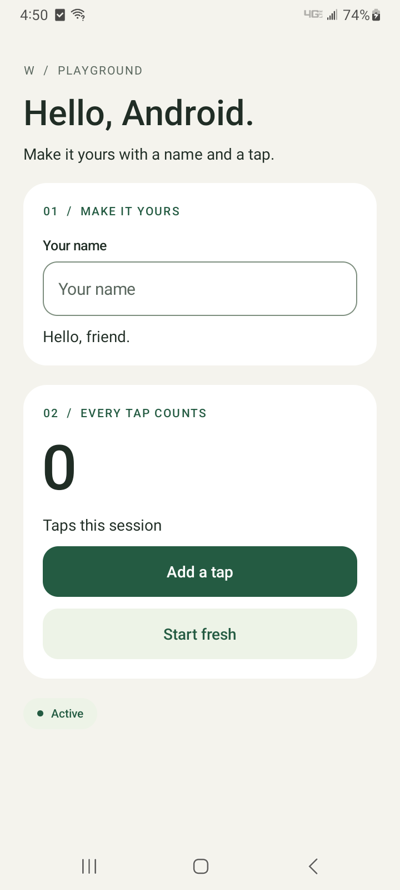
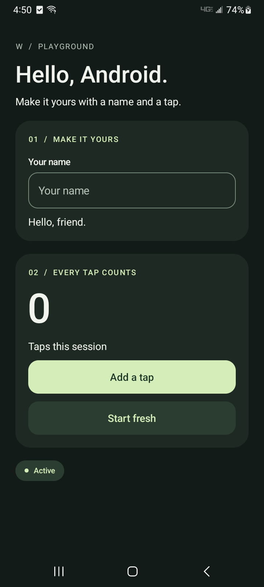

# Experimental Android support

`arm64_android` targets 64-bit Android using the existing AArch64 emitter,
Android-specific runtime modules, and ELF output with 16 KB LOAD/RELRO
alignment. Plain programs are static PIE executables; programs importing
`c_lib` libraries use `/system/bin/linker64`. Use Android library names such
as `libc.so`, not glibc's `libc.so.6`. `--shared` emits an Android shared
library with AAPCS64 adapters for `export` functions. No NDK is needed to
compile ordinary W programs or the compiler itself.

Android defaults to `--pac=off` for the ARMv8.0 baseline. Explicit
`--pac=ret`/`--pac=full` require a device supporting pointer authentication;
they are not suitable for every Android CPU or emulator.

```sh
./wbuild build
bin/wv2 arm64_android --strict hello.w -o bin/hello_android
bin/wv2 arm64_android --shared graphics/android/demo.w -o bin/libwapp.so
```

The target works with `check`, `deps`, `symbols`, and `defhash`. Architecture
imports resolve through `__arch__/arm64_android`. The Android OS identifier
is 4; ISA and word size remain ARM64 and 8 bytes. Android uses raw kernel
syscalls for the W runtime. Its wrappers avoid `statx` and `close_range`,
which are not available under every Android app seccomp policy. Page-size
discovery uses the initial auxiliary vector or `/proc/self/auxv`, with an
allocation-free mapping probe fallback. Guard allocation and stack probing
use that runtime size. Android guard pages remain reserved with `PROT_NONE`
so another mapping cannot reuse the guard hole. Shell lookup respects PATH and falls back to
`/system/bin/sh`.

## Building on an ARM64 Android device

The initial supported command-line environment is Termux in its private
home directory. Shared storage such as `/sdcard` is unsuitable for build
executables. Install Git, a shell, and the usual core utilities in Termux.
An ARM64 Android seed is not yet published or pinned in `SEEDS`; a desktop
checkout supplies the initial local seed:

```sh
# On an existing supported build host:
./wbuild android_seed
# Transfer bin/w_android into the Android checkout as ./w_android.
```

Then, inside the Android checkout:

```sh
chmod +x w_android
sh ./wbuild build
sh ./wbuild verify
sh ./wbuild tests
```

`wbuild` detects Android and bootstraps `bin/wv2_android` and
`bin/wexec_android`. Native host planning maps `build`, `verify`, and `tests`
to the Android targets while retaining explicit cross-compilation selectors.
`verify_android` checks a compiler self-host fixpoint. `tests_android` is an
explicit, smaller device suite; it does not claim the complete desktop Linux
suite works on Android. `update_android` promotes a verified compiler to the
local seed only. A future published seed must follow the single-release-tag
rules in [release.md](../release.md), including real hashes for every pin.

## Native Android app

`graphics/android/ui.w` provides a small native-controls bridge: labels,
buttons, and single-line text fields. W owns application state; Android owns
rendering, keyboard/IME, scrolling, insets, and standard accessibility.
The demo uses light/dark palettes that follow the system, rounded sections,
52 dp buttons, persistent field labels, and a scrollable column capped at
560 dp on wide screens. Text respects Android's font-size setting. Primary
and secondary buttons retain native ripple feedback and keyboard focus;
Done dismisses the software keyboard.

The original label/button/text-field API remains available. Optional
presentation roles are `wandroid_heading`, `wandroid_caption`,
`wandroid_value`, `wandroid_status`, and `wandroid_secondary_button`.
`wandroid_section(title)` begins a new card; another section starts a sibling
card, and `wandroid_section_end()` returns to the page. Sections do not nest.
These label roles, including section headings, return handles usable with
`wandroid_label_set`. A text field's hint also serves as its persistent,
accessibility-associated label. The demo's **Start fresh** button resets
the counter; clearing the name restores its greeting.




The existing OpenGL widget renderer has not been ported to native Android.
The browser/Wasm route remains available separately.

Requires an installed Android SDK platform 35 or newer, Build Tools 35 or
newer, an NDK (r28 or newer recommended), a JDK, and Python 3.9 or newer. The build
script runs on Linux or macOS and uses these installed tools directly; it does not download packages
or require Gradle. Set `ANDROID_HOME`/`ANDROID_SDK_ROOT`, or use `--sdk`.
`--ndk` and `--compiler` override automatic NDK selection and `bin/wv2`.

```sh
python3 tools/android/build.py
adb devices
python3 tools/android/smoke.py --serial DEVICE_SERIAL
```

Output: `bin/android/app/WApp.apk` and `preview.png`. The APK is a debuggable
development build signed with a generated local key under `bin/android/`.
It targets API 35, requires API 28, and packages only `arm64-v8a`. Custom
sources can replace the demo argument to `build.py`; they must implement:

```text
export void wandroid_setup()
export void wandroid_event(int handle, int kind, char* value)
export void wandroid_lifecycle(int phase)
```

All callbacks execute on the Activity UI thread. Handles are one-based and
reset when Android recreates the Activity; initialize W state in setup.
Event kinds are 1 for button clicks and 2 for edited text. The UTF-8 value is
borrowed for the callback duration; copy it before retaining. Phase 1 means
active and 2 background. The JNI bridge uses byte arrays for text so Unicode
outside the BMP survives round trips. Persisting state across process death
is the application's responsibility.

ARM64 export adapters preserve native callee-saved registers and reserve a
256 KiB W evaluation stack below the native frame. Keep callbacks within
that stack capacity. Exported library functions are regular C ABI functions;
ordinary W function pointers are not interchangeable with C callbacks.
Android native linking supports function imports and exports; external data,
thread-local storage, and W static-library output remain unsupported.

## Packaging other apps

`build.py` packages any W source that exports the three callbacks. Other
repositories pass their own identity and options; the defaults reproduce
the demo:

```sh
python3 tools/android/build.py /path/to/app.w --import-root /path/to/repo \
    --package org.example.app --label "Example" --icon icon.png \
    --theme daynight --min-sdk 29 --internet --scheme example \
    --out /path/to/repo/bin/android --apk-name Example.apk
```

`--icon` generates the launcher icon at build time with the JDK
(`tools/android/icon/WIcon.java`, no downloads): density mipmaps (mdpi to
xxxhdpi), an adaptive icon with a themed (monochrome) layer, and a white
notification glyph. A "tile" icon, an opaque one-color shape around a glyph,
becomes that color behind the glyph; other artwork is scaled into the safe
zone over white. `--icon-background #RRGGBB` overrides the detected color.
`--notifications` adds `POST_NOTIFICATIONS` (a runtime permission on API
33+), the foreground-service permissions and `WService` for
`wandroid_notify` and `wandroid_background`.

`--theme daynight` uses the device's DayNight theme without an action bar
(API 29+); `light` remains the default. `--internet` adds the INTERNET
permission and a network security configuration that allows cleartext HTTP
only to `127.0.0.1` and `localhost` (for `adb reverse` development); other
hosts need HTTPS. Each `--scheme` adds a VIEW/BROWSABLE intent filter and
makes the Activity `singleTask`, so later links reach the running app.
`--keystore` (or `W_ANDROID_KEYSTORE`) selects the development signing
keystore, created if missing; by default every app built from one W checkout
shares `bin/android/debug.keystore`, so updates install over each other.
`--keystore-pass` and `--key-alias` match an existing keystore. The Java
Activity keeps the class name `org.wlang.androiddemo.WActivity` whatever the
application id, because the JNI entry points name it.

## IDE-companion controls

`graphics/android/kit.w` adds optional controls for richer apps such as the
Wide companion; `graphics/android/kit_demo.w` is a compact example. The
bridge is `tools/android/kit.c` plus `WKit.java`; the basic API is unchanged.
New control and event numbers start at 32.

- **Screens:** `wandroid_screen(title, flags)` pushes a screen with a top bar
  (title, Up arrow, `wandroid_action` text actions) and makes it the target
  for new controls, including labels, buttons and fields. Fixed screens give
  lists, text views and fill areas the free height; `android_screen_scroll`
  scrolls form content. `wandroid_screen_pop`/`_clear`/`_depth` manage the
  stack. With two or more screens, Back and Up send `android_event_back`, and
  W decides whether to pop. Android 13+ delivers Back through an
  `OnBackInvokedCallback` registered only while W owns it (the manifest opts
  in to `enableOnBackInvokedCallback`), so predictive back-to-home still
  works from a root screen; Android 9-12 use `onBackPressed`. Top-bar
  actions move to right-aligned lines under the title when it would be
  squeezed (large fonts, narrow windows); short windows get a lower bar and
  tabs. `wandroid_tab` adds persistent bottom tabs, announced to TalkBack as
  tabs with their position and selection.
  `wandroid_row` ... `wandroid_row_end` lays out controls side by side.
- **Recreation:** rotation, theme and font-scale changes recreate the
  Activity and reset handles, but the library and W state stay loaded.
  Screen scroll positions, list rows, text-view and area selections and
  scroll, and focus are saved with the Activity state and reapplied, by
  screen and control position, to screens that setup rebuilds with the same
  titles and controls in the same order. List positions are applied when the
  rows arrive within 15 s. Text areas do not save their text (it can exceed
  the Binder limit, and secret fields stay out of saved state); W receives
  every edit and sets it again. State is not restored after process death.
- **Lists:** `wandroid_list` with two-line rows (`_add`, `_set`, `_clear`);
  a tap sends `android_event_item` with the decimal row index.
- **Text:** `wandroid_text_view(text, flags)` is read-only and selectable:
  monospace (or proportional), optionally wrapped, with unified-diff colors
  or tail-following `wandroid_text_append` styled by role. `wandroid_text_area`
  is multi-line input that reports `android_event_text` (a fill area, used as
  an editor, places the cursor at the start when W sets its text). `wandroid_text_set`,
  `_get`, `wandroid_style`, `wandroid_enable`, `wandroid_show` and
  `wandroid_focus` work on any handle that supports them.
- **Dialogs:** `wandroid_dialog(title, message, "Allow\nDeny\nAlways")` and
  the list form `wandroid_choose` answer with `android_event_dialog` (the
  index, or -1 when dismissed); `wandroid_toast` shows a short message.
- **Timers:** `wandroid_timer(ms, repeat)` sends `android_event_timer`.
- **HTTP:** `wandroid_http(method, url, headers, body)` runs
  `HttpURLConnection` on a worker thread. `android_event_http` delivers
  `"STATUS\nBODY"` on the UI thread; status 0 reports a transport failure.
  Redirects are not followed and bodies are limited to 16 MiB.
- **Secrets:** `wandroid_secure_put/get/delete` encrypt values with an
  AES-GCM key held in AndroidKeyStore and keep only ciphertext in private
  SharedPreferences.
- **Deep links:** `wandroid_intent_uri` reads the launching URI; later links
  arrive as `android_event_uri`.
- **Notifications:** `wandroid_permission(name)` returns 1 when granted, or
  -1 after asking (the answer arrives as `android_event_permission`, "1" or
  "0"). `wandroid_notify(id, title, text)` posts or replaces a notification;
  tapping it opens the app and sends `android_event_notification` with the
  id. `wandroid_background(text)` starts a `dataSync` foreground service
  with an ongoing notification so timers and HTTP keep running while the app
  is in the background (call it while the Activity is still visible, e.g. in
  lifecycle phase 2); `""` stops it. Both need `build.py --notifications`
  and return 0 otherwise. Android 15 limits that service type to six hours a
  day.

Timer, dialog and HTTP ids are a separate number space from control handles;
the event kind identifies them. Timers and dialogs end with their Activity.
HTTP results are delivered to the current Activity, including one recreated
while the request was in flight. Text crosses JNI as UTF-8 byte arrays in both
directions, and query results are copied into W-owned buffers.

## Validation

The ordinary host suite includes Android ELF structure, host planning,
bootstrap selection, runtime layout, strict build-tool cross compilation,
and demo shared-library checks. These need neither an SDK nor a device:

```sh
./wbuild android_elf_test android_bootstrap_test android_build_tools_compile_test android_app_test android_kit_test
```

`android_kit_test` builds the kit example and runs `tools/android/check_bridge.py`,
which checks that every W `extern` has a C definition with the same arity and
that `kit.c`, `WKit.java`, `kit.w` and `WActivity` agree on operation codes,
event kinds and JNI signatures. On a device, `tools/android/kit_smoke.py`
exercises screens, lists, text, secrets, a timer, HTTP through `adb reverse`,
Back, a dialog, a deep link and the permission/background fallbacks (see its
usage text for the build command). It passed on the Samsung SM-S134DL
(Android 13, 4 KB pages) with the DayNight theme, and on an Android 16
emulator image with 16 KB pages, where Back goes through
`OnBackInvokedCallback`. The Wide companion's end-to-end test, built on these
controls (recreation, notifications, background work, large fonts,
landscape and a tablet-sized display), passed on both.

The optional device probes test exported integer/float arguments, stack
spills, relocated data, and a W compiler running inside Android's app sandbox:

```sh
python3 tools/android/build.py --probes
python3 tools/android/smoke.py --serial DEVICE_SERIAL --probes
```

The probe APK packages `compiler/cli.w` as a shared library and the runtime
sources as assets. It calls `compiler_main` once to compile a W fixture on
the device, loads that generated library, and checks containers, allocation,
page-size discovery, and guard allocation. It also exercises native controls,
W state changes, counter reset, empty-name fallback, Unicode input, and the
active lifecycle callback. The smoke check recreates the Activity and repeats
the UI checks; compiler probes run once per process so a rotation or theme
change cannot re-enter the compiler's one-shot entry point. This
embedded-compiler test does not replace the Termux compiler fixpoint test.

The APK probes have passed on Android 16 emulator images with 4 KB and
16 KB pages, running ARM64 libraries through `libndk_translation` on an
x86-64 host. The native controls, integer/float ABI, embedded compiler,
generated shared library, containers, and page-aware guard allocator were
exercised on both images. The screenshot produced by the 4 KB run was
visually inspected. These runs validate Android loader and sandbox behavior
but do not substitute for execution on physical ARM64 hardware.

Command-line self-hosting and executor termination can be reproduced over adb:

```sh
python3 tools/android/selfhost.py --serial DEVICE_SERIAL
ANDROID_SERIAL=DEVICE_SERIAL ./wbuild android_executor_signal_device_test
```

The self-host script builds a Bionic-linked ARM64 seed, stages its exact
source dependency closure under `/data/local/tmp/w-android-selfhost`,
checks `wv3 == wv4 == wv5`, and runs the runtime smoke. Both 4 KB and 16 KB
emulator runs passed, producing byte-identical compilers across page sizes.
The executor test also passed on both: SIGTERM exits 143, kills the child,
and releases its build lock. These commands require native ARM64 execution
or configured ARM64 binfmt translation. The dynamic dependency is necessary
for the emulator's program runner, which rejects static executables; these
adb-shell checks do not qualify the static-seed Termux bootstrap.

Physical-device validation passed on a Samsung SM-S134DL running Android 13
with 4 KB pages, using main commit `dd348fea`: native controls, Unicode,
lifecycle, ARM64 ABI, embedded compilation/execution, runtime smoke,
`wv3 == wv4 == wv5`, and executor SIGTERM cleanup. The static Android seed
also compiled and ran the runtime smoke under adb. This qualifies the tested
device; it does not cover physical 16 KB devices or the Termux environment.

Termux self-hosting, native debugging, and release distribution still
require separate qualification. Android's app sandbox and
execution policies still apply; the presence of a desktop API in an import
closure does not make it usable inside an ordinary Android app.

References: [Termux execution environment](https://github.com/termux/termux-packages/wiki/Termux-execution-environment),
[Android page sizes](https://developer.android.com/guide/practices/page-sizes),
[Bionic linker requirements](https://android.googlesource.com/platform/bionic/+/master/android-changes-for-ndk-developers.md),
[Android app sandbox](https://source.android.com/docs/security/app-sandbox),
[View accessibility](https://developer.android.com/guide/topics/ui/accessibility/views/apps-views),
[edge-to-edge layouts](https://developer.android.com/develop/ui/views/layout/edge-to-edge).
