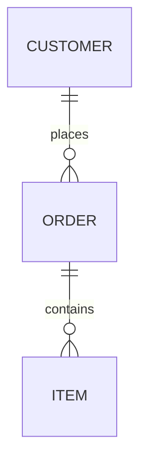

# Native Mermaid diagrams

The native engine provides a W parser, owned document model, lossless source writer,
source-edit API, deterministic layout, SVG exporter, CLI, and native desktop
editor with live preview and flowchart/ER/class/state canvas editing. It has no Mermaid JavaScript, Node,
browser, network, or external layout dependency. The desktop uses the existing
`graphics.ui` and native OpenGL stack. The library and CLI run on x86 and x64;
the desktop has Linux X11 workflow tests, Windows cross-compilation and Wine
smoke coverage, and macOS ARM64 cross-compilation. Native Windows/macOS desktop
qualification remains outstanding; see the platform table below.

The family-coverage milestone is implemented: every authoring family in the
pinned Mermaid **12.2.0** registry has a bounded native core, including all five
C4 headers, all four railroad notations and agentflow. ZenUML is also supported.
The [compatibility matrix](mermaid_compatibility.md) lists every family, runnable
examples, implemented semantics and remaining gaps. This is **not full Mermaid
compatibility**: syntax, configuration, styling, layout and editing depth remain
incomplete.

Supported documents share read/write, source editing, native preview and SVG
export. Unsupported syntax produces a diagnostic and suppresses the preview;
the original document remains readable, editable as source, and saveable without
data loss. Markdown or HTML inside accepted plain labels is displayed literally.

## Use

```sh
./wbuild wmermaid wmermaid_editor
bin/wmermaid check examples/mermaid/orders.mmd
bin/wmermaid read examples/mermaid/orders.mmd
bin/wmermaid write examples/mermaid/orders.mmd bin/orders.mmd
bin/wmermaid svg bin/orders.mmd bin/orders.svg
bin/wmermaid_editor bin/orders.mmd
bin/wmermaid_editor examples/mermaid/classes.mmd
bin/wmermaid_editor examples/mermaid/states.mmd
```

`write` preserves the original bytes, including comments and CRLF. It is not a
formatter. `edit INPUT START END REPLACEMENT_FILE OUTPUT` replaces the half-open
UTF-8 byte range `[START, END)` and writes the result; replacement text is read
literally from the file. Invalid intermediate syntax is allowed in source edits
and writes. Run `check` to validate, or `svg` to validate and export. Neither
command accepts an invalid document as a successful diagram. Diagnostics go to
stderr with one-based line/byte-column positions; failed commands exit nonzero.
SVG export validates before touching its destination.

The desktop opens the named source. Edit text on the left to update the preview.
The path field and **Open** load another file; **Save** saves the current file,
and **Save as** creates a new file at the path field (existing destinations are
refused). **Undo/Redo** retain 32 source snapshots; consecutive source typing is grouped
until a 500 ms pause or editing boundary. **Previous/Next diagram**
select a Mermaid fence while keeping the complete Markdown source editable.
The dynamic path field supports paths beyond the former 127-byte limit.

For flowcharts, ER, class (`classDiagram`) and state (`stateDiagram`,
`stateDiagram-v2`) diagrams, clicking a node selects it and populates the
inspector. **Apply** changes its displayed label; **Delete** removes the node
and its incident connections. Clicking a connection selects it for deletion.
Edits preserve unrelated source, comments, styles, configuration and other
Markdown fences; deleting edges also updates indexed `linkStyle` assignments.
Each graphical operation is one undo step, and failed edits leave the document
unchanged. Group containers remain source-edited.

Every graphical edit is a source splice validated by reparsing: the result must
keep every other node (label, shape, members, annotation, attributes, scope,
styles), every other edge in order, the notes, class definitions, direction,
title and accessibility text, or nothing changes. `mm_editor_edit_reason`
returns the reason an operation is unavailable (empty when it is available).

| Family | Select / drag / Auto layout | Rename | Delete node | Delete connection | Add / Link to |
| --- | --- | --- | --- | --- | --- |
| Flowchart | top-level nodes | appends `ID[label]` keeping the shape | removes it from chains, `style`/`class`/`linkStyle` targets | yes | `ID["label"]`, `A --> B` |
| ER | top-level entities | appends `ID[label]` | removes its relationships; attributes stay with survivors | yes | `ID["label"]`, a default `\|\|--\|{` relationship |
| Class | top-level classes | appends `class ID["label"]` | removes its declaration/body, `<<annotation>> ID`, `ID : member` lines, relationships, `note for ID`, `style`/`cssClass` targets | yes | `class ID["label"]`, association `A --> B` |
| State | top-level states | appends `ID : label` (plain states only) | removes its declarations, descriptions, transitions, `note ... of ID`, `style`/`class` targets; a `[*]` left without transitions goes too | yes | `ID : label`, `A --> B` (`[*] --> A`, `A --> [*]` from start/end) |

A class or state whose only mention was a removed relationship is redeclared in
place (`class Leg~T~`, or a bare state `Idle`), so deleting a connection never
deletes its endpoints. Namespaces, composite states and nodes inside them
are edited in source; so is any deletion that would reach inside a namespace or
composite body, and class deletions in diagrams with lollipop `()--`
interfaces, whose synthetic identities are positional. Start, end, choice,
fork and join states have no editable label. Notes are not selectable on the
canvas; they follow their node and are deleted with it.

Drag a top-level node to reposition it; edges follow live. Release commits one
undo step, while Escape restores the starting position. Small pointer jitter
selects without moving. **Move here** followed by a destination click provides
a non-drag alternative. Arrow keys move the selected node by one layout pixel,
or ten with Shift. Background dragging pans the view. Wheel zoom stays anchored
under the pointer, **Fit** centers the diagram, and edits retain the camera.
**Auto layout** clears the selected diagram's saved positions in one undoable
action and fits the result. The source/canvas divider is resizable. Nested nodes can be selected and relabelled
or deleted, but moving them or their containing groups is not yet supported.

**Add** creates a flowchart node, ER entity, class or state from the inspector
fields. **Link to** then a destination click adds a flowchart arrow, a default
ER relationship, a class association or a state transition; edit relationship
kind, cardinality and labels in source.
**SVG** writes `CURRENT_FILE.svg` using the saved manual positions too.

| Shortcut | Action |
| --- | --- |
| Ctrl+S | Save |
| Ctrl+Z / Ctrl+Shift+Z / Ctrl+Y | Undo / redo / redo |
| Ctrl+D / Ctrl+E / Ctrl+L / Ctrl+R | Focus canvas / source / path / label |
| Ctrl+Enter, with label focus | Apply the selected node's label |
| Ctrl+N | Start adding a new node/entity |
| Tab / Shift+Tab, with canvas focus | Select next / previous node |
| Arrows / Shift+arrows, with canvas focus | Move selected node 1 / 10 pixels |
| Delete, with canvas focus | Delete selected node or connection |
| Escape | Cancel a drag, placement, connection or close prompt |
| Ctrl+0 / Ctrl+plus / Ctrl+minus | Fit / zoom in / zoom out |
| Ctrl+Q | Close with the unsaved-change prompt |

Canvas navigation and Delete are scoped to canvas focus, so editing text does
not delete diagram objects. Command chords are also accepted where the native
backend reports them. Controls for unsupported operations are disabled.
The interaction choices follow [W3C's non-drag alternative guidance](https://www.w3.org/WAI/WCAG22/Understanding/dragging-movements)
and [GNOME's guidance on reversible actions](https://developer.gnome.org/hig/principles).
This does not claim full accessibility conformance or screen-reader integration.

Manual positions use ordinary comments such as `%% @w-position "A" 100 120`
inside the selected diagram. Coordinates are nonnegative layout pixels bounded
at 100,000 per axis, before the title gutter. Only real comment statements are
interpreted; similar text in labels or accessibility descriptions is not metadata.
Other Mermaid implementations ignore these comments and use their own layout.
Lossless save/reopen retains positions; canonical output deliberately discards
comments, including these position hints.

The editor asks to save/discard/cancel on close with unsaved changes. Opening
another file requires saving changes first. External content changes are detected
and saving refuses to overwrite a changed, deleted, or unreadable disk file.
**Reload** refreshes the disk version, with a discard confirmation for local
changes. The check is optimistic, not an atomic compare-and-swap against a writer
racing the final save. The core file layer uses `lib.fs` atomic durable replacement;
Save As uses exclusive creation. Save failure preserves editor dirty state.
The filesystem module's post-publication directory-sync failure semantics apply.
Errors clear the preview while leaving the original text editable and saveable.

`--diagram N` selects a zero-based Mermaid fence in CLI check/read/write/edit/svg
and canonical operations (default 0). Read/write/edit preserve the complete source;
check/svg operate on the selected diagram. `canonical INPUT OUTPUT` emits a
standalone flowchart or ER diagram from its semantic model, including groups,
styles, attributes and relationships. It deliberately replaces comments and
formatting. Unsupported families, themes/force configuration, or unrepresentable
model values fail explicitly. Lossless `write` behavior is unchanged.

For a reproducible native preview on a headless Linux host with Xvfb:

```sh
xvfb-run -a bin/wmermaid_editor examples/mermaid/orders.mmd \
  --frames 3 --screenshot bin/mermaid.ppm
bin/ppm_to_png bin/mermaid.ppm bin/mermaid.png
```

## Desktop validation by platform

| Platform | Checked here | Still needed |
| --- | --- | --- |
| Linux x64 / X11 | Native editor workflow with real pointer/key events under Xvfb; screenshot/export and save/reopen | Physical display, input-method and assistive-technology qualification |
| Windows x64 / WGL | PE cross-compile and Wine/Xvfb startup/render/screenshot smoke | Native Windows input, clipboard, DPI and filesystem qualification |
| macOS ARM64 / Cocoa | Mach-O cross-compile | Native Mac execution, input, clipboard, Retina and filesystem qualification |

`./wbuild mermaid_editor_platforms` cross-compiles both desktop binaries and is
part of the full suite. `./wbuild mermaid_editor_ui_test` runs the Linux workflow
and requires Xvfb plus the X11/XTest shared libraries. It fails if the display or
editor cannot start; it does not silently count a skipped GUI run as a pass.
The normal suite also includes display-independent canvas, edit-command and
position-persistence tests on x86/x64.

```sh
# Windows smoke on a Linux host with Wine and Xvfb; use an isolated Wine prefix.
xvfb-run -a env WINEPREFIX="$PWD/bin/mermaid-wine-prefix" WINEARCH=win64 \
  wine bin/wmermaid_editor_win.exe examples/mermaid/build.mmd \
  --frames 3 --screenshot bin/mermaid-windows.ppm
# Execute on an Apple Silicon Mac after cross-compiling:
bin/wmermaid_editor_darwin examples/mermaid/build.mmd --frames 3 \
  --screenshot bin/mermaid-macos.ppm
```

## Flowchart and ER compatibility

Syntax references: [Mermaid flowcharts](https://mermaid.js.org/syntax/flowchart.html)
and [Mermaid ER diagrams](https://mermaid.js.org/syntax/entityRelationshipDiagram.html).
These describe upstream syntax; the table below defines the implemented subset.

| Area | Implemented |
| --- | --- |
| Input | Raw UTF-8 `.mmd` source or a selected Mermaid Markdown fence, BOM, LF/CRLF, `%%` comments, semicolon separators |
| Flow header | `flowchart` or `graph`, followed by `TB`, `TD`, `BT`, `LR`, or `RL` |
| Flow nodes | Bare IDs, rectangle `[label]`, rounded `(label)`, circle `((label))`, double circle `(((label)))`, diamond `{label}`, stadium `([label])`, subroutine `[[label]]`, cylinder `[(label)]`, asymmetric `>label]`, hexagon `{{label}}`, parallelograms and trapezoids; quoted labels; `A@{ shape: ..., label: ... }` metadata with every Mermaid 12.2 shape name and alias (documents, stacked/lined/divided/tagged rectangles, braces, forks, flags, bolts, hourglass, ...), `icon`/`img` placeholders and `w`/`h`/`pos`/`constraint` |
| Flow edges | `-->`, `---`, `-.->`, `==>`, `<-->`, `o--o`, `x--x`, invisible `~~~`, extended lengths (up to 16), `-- text -->` and `|label|`, `&` groups, chains, cycles, self edges; edge IDs `e1@-->` with `e1@{ animate: true, curve: linear }` |
| Interaction | `click ID href "url" "tooltip" _blank`, `click ID "url"`, `click ID call fn()` and bare callbacks; links render as SVG `<a>` only for relative, fragment, http(s) and mailto URLs, callbacks are kept in the model and never run |
| ER entities | Bare/quoted names, standalone entities, `[alias]`, attribute blocks |
| ER attributes | `type name`, `PK`/`FK`/`UK` and comma-separated combinations, quoted comments, array/parenthesized/nullable types, `*` primary-key name spelling |
| ER relationships | All 16 symbolic cardinality combinations plus textual aliases (`only one`, `zero or many`, etc.); `--` / `to` identifying and `..` / `optionally to` non-identifying; required `: label` |
| Grouping | Nested `subgraph ID[label] ... end` in flowcharts and ER; scoped directions and compound bounds |
| ER direction | `direction TB`, `BT`, `LR`, or `RL` |
| Rendering | Entity attribute rows, relationship text, crow's feet, optional circles, one bars, dashed/solid edges; shared scene for native and SVG output |

Attributes occupy separate lines (or one attribute before a closing brace).
Labels support `<br>` line breaks, multi-line Markdown strings with
`**bold**`/`*italic*` emphasis and wrapping at 200px; other HTML, Mermaid entity
escape codes and rich labels are shown literally (see
[Text layout](mermaid_text.md)). Native glyph coverage follows the UI font
system; SVG uses a matching sans-serif face, and graph labels are measured with
the native preview's per-glyph widths.
ER attributes show type, name, keys and comment in each row rather than separate
resizable columns. Layout uses longest-path ranks with deterministic cycle
breaking, stable barycentric crossing-reduction sweeps and orthogonal connectors.
It is not upstream Dagre/ELK: complex cycles,
parallel edges and long labels may overlap and need future routing work.

Node styles/classes and a bounded frontmatter theme subset are implemented;
see [Styles and themes](mermaid_styling.md). Remaining gaps include
most configuration options, icon packs and remote images (shown as placeholders),
Font Awesome text and other rich text. Class and state coverage is listed below; other families are listed in the
[compatibility matrix](mermaid_compatibility.md).

## Native graph layout selection

The default layered layout also accepts frontmatter `config.layout: dagre` as
an input alias; this selects the W implementation, not the upstream Dagre engine.
The native extension `config.layout: force` selects deterministic force-directed
placement for flow, ER, class, state, requirement, C4, architecture, use-case and
agentflow graphs. Each group is laid out independently and sized around its
children. Fixed iteration budgets and a final collision pass keep sibling boxes
disjoint and repeated exports reproducible. Dense edge routing and labels can
still overlap. Unsupported layout names and force layout on other families are
diagnosed rather than silently ignored.



## Class and state compatibility

The UML syntax baseline is pinned to Mermaid **12.2.0**:
[class syntax](https://github.com/mermaid-js/mermaid/blob/mermaid%4012.2.0/packages/mermaid/src/docs/syntax/classDiagram.md),
[state syntax](https://github.com/mermaid-js/mermaid/blob/mermaid%4012.2.0/packages/mermaid/src/docs/syntax/stateDiagram.md).
This is subset coverage, not a claim of upstream rendering or syntax parity.

| Family | Implemented |
| --- | --- |
| Class declarations | `classDiagram`, `class ID`, `class ID["label"]`, member blocks, `ID : member`, `<<annotation>>` in blocks, before IDs, or after declarations |
| Class members | Literal visibility/type/signature text, separated into attribute and operation compartments by the presence of `(`; input order is retained within each compartment |
| Class relationships | Solid `--` and dashed `..`; optional open arrow, hollow triangle, filled composition diamond or hollow aggregation diamond at either end; quoted multiplicities and `: label` |
| Class grouping | Nested `namespace Name { ... }`, globally unique class IDs, relations across namespaces, declarations that assign previously referenced classes to their namespace |
| State declarations | `stateDiagram` / `stateDiagram-v2`, bare IDs, `state "label" as ID`, `ID : description` |
| State transitions | `-->`, optional `: label`, cycles/self transitions, scope-local `[*]` initial and final nodes |
| State structures | Nested `state ID { ... }`, transitions to/from composites, `<<choice>>`, `<<fork>>`, `<<join>>` |
| Direction | Top-level and group-local `direction TB`, `TD`, `BT`, `LR`, `RL`; children inherit their containing group's direction |
| Output and editing | Shared native/SVG geometry, lossless read/write and source edits, editor preview/history/save and top-level canvas editing (select, drag, rename, delete, add, link) for both families |

Groups reserve space for their children before the containing graph is laid out.
Namespaces render as labeled containers; composite states render with their own
initial/final nodes. Class relationships retain separate endpoint types and
multiplicity labels. Class names remain globally unique; state transitions across
scopes route through their nearest common containing group. A group may contain at most 32 nested group levels. Class members
share the 4,096-document / 1,024-node attribute budget.

Class declarations additionally support nested generic parameters, backtick IDs,
dotted namespaces with labels, unique lollipop interfaces and notes. State
transitions support forward declarations across composite boundaries, plus
left/right multiline notes. See [UML additions and limits](mermaid_uml.md) for
exact identity, ownership and placement rules.

Concurrent state regions, rich text, comma-separated generic
parameters and full configuration remain unsupported. Node styles/classes,
accessibility statements and class `link`/`click`/`callback` statements (safe
SVG links and tooltips) are supported. Members display with `~T~` generics as
`<T>`, methods as `name(params) : Return`, `$` static members underlined and
`*` abstract members in italics; annotations display literally. Unsupported
structures fail parsing and clear the preview while preserving editable source.
Automatic routing can still overlap connectors or labels across boundaries.

## Markdown, titles and accessibility

A source document can contain multiple backtick or tilde Mermaid fences. The
parser ignores other-language fences, defaults to the first Mermaid diagram,
and preserves all surrounding prose and line endings. Select another diagram
with `mm_parse_selected`, CLI `--diagram N`, or the editor's previous/next buttons.
Out-of-range selections and unterminated fences produce diagnostics. Parse
locations and byte-range edits refer to the original complete source; immutable
edits retain the selected diagram index. See `examples/mermaid/document.md`.

Plain `title:` frontmatter is supported at the beginning of a raw diagram or
inside the selected fence. Quoted scalar
titles are accepted. The frontmatter parser also accepts the bounded `config`
theme subset described in [Styles and themes](mermaid_styling.md); it is not a
general YAML parser. Other structured values, YAML escapes and unsupported
configuration fields produce diagnostics.

`accTitle:` and `accDescr:` (including brace-delimited multiline descriptions)
provide escaped SVG title/description metadata across families, including the
indentation-based mindmap, Kanban, TreeView and Ishikawa parsers. Metadata does
not alter hierarchy indentation. Frontmatter titles are visible in native preview
across families. Source edits preserve metadata.

## Styles and themes

Flowchart, ER, class and state diagrams support node `style`, `classDef` and class
assignment, with fill, border/text colors and integer stroke widths. Styles
resolve consistently into native and SVG primitives, including transparent fills.
The five frontmatter theme names `default`, `base`, `dark`, `forest` and `neutral`
select native palettes. With `base`, six quoted-hex `themeVariables` are supported.
[The styling reference](mermaid_styling.md) defines precedence, accepted names,
limits and exact indentation. This does not provide general CSS, upstream theme
parity, font overrides or arbitrary diagram configuration.

## W library

```w
import libs.extras.mermaid.parser
import libs.extras.mermaid.render

char* source = c"erDiagram\nCUSTOMER ||--o{ ORDER : places\n"
mm_document* doc = mm_parse(source, strlen(source))
if (doc.error == 0):
	mm_scene* scene = mm_render(doc)
	char* svg = mm_svg(scene)
	# Consume svg here; it is owned by the caller.
	free(svg)
	mm_scene_free(scene)
mm_document_free(doc)
```

- `model`: `mm_document`, nodes, attributes and edges; `mm_write(doc)` returns
  owned source text; `mm_document_free` frees the complete document.
- `source`: lossless Markdown/frontmatter envelopes and original-document offsets.
- `scene`: owned backend-independent primitives and escaped SVG metadata.
- `parse_common` / `uml`: bounded lexical helpers and class/state parsers.
- Family modules: graph/workflow parsers and layouts, `data_parse` / `data_render`,
  narrative parsers/renderers, `railroad_parse` / `railroad_render`, and `agentflow`.
  Their owned models preserve family-specific semantics.
- `style` / `style_render`: bounded style parsing, resolution and scene palettes.
- `parser`: `mm_parse(bytes, length)` copies input and returns an owned result,
  including failures. `error == 0` means successful subset parsing.
  `mm_edit(doc, start, end, replacement, length)` returns an independent reparsed
  document; null means invalid range/budget or a split UTF-8 codepoint. The old
  document is unchanged. Fields are inspectable; edit source and reparse to keep
  the model and lossless writer consistent. `mm_write` always returns original bytes.
  `mm_parse_selected(bytes, length, index)` selects a zero-based Markdown diagram.
- `serialize`: `mm_serialize(doc)` returns canonical standalone flow/ER source from
  the model, or null if the model cannot be represented without dropping semantics.
- `render`: `mm_render(doc)` returns an owned display list, or null for a failed
  parse; `mm_svg(scene)` returns owned escaped XML. `mm_scene_free` releases it.
- `io`: `mm_read(path)` returns an owned document, or null for I/O/budget failure;
  `mm_save(doc, path, io_result*)` returns an `IO_*` status. `mm_diagnostic` returns
  an owned location/message string.
- `editor`: UI-independent source history, diagram selection, structured flowchart
  additions, hit testing, dirty state, conflict checking, reload, save and gesture state.
- `edit_commands`: transactional label/delete commands for flowchart, ER, class
  and state diagrams, `mm_editor_edit_reason`, ER/class/state additions
  (`mm_editor_add_graph_node`) and connections (`mm_editor_connect`).
- `positions`: bounded source position hints applied before rendering connections.
- `canvas`: display-independent selection, movement, navigation and connection state.
- `graphics.mermaid`: `mm_ui_render` draws a scene into a clipped viewport with
  zoom and pan using an existing `ui_renderer`.

The shared source limit is 1 MiB. Graph documents permit at most 1,024 nodes and
1,024 edges; graph attributes/members have 1,024-per-node and 4,096-document
budgets. Common graph/container nesting is capped at 32 levels. Some families
have different limits: hierarchy depth, data values/entries, railroad expressions
and metadata budgets are specified in their linked references. Parsing rejects
invalid UTF-8, embedded NUL and non-whitespace ASCII controls. Source bytes remain
available on syntax failure. A scene owns its strings and geometry independently
of the document. Callers own every returned object/string and must free them.

## Delivered stages and remaining work

Native core coverage is delivered for the foundation/UML families, fourteen
additional graph and workflow families, five ordered narrative families, eight
data families, railroad's four notations and agentflow. Markdown source envelopes,
titles, accessibility metadata and bounded styles/themes are also delivered.
See the [pinned inventory and per-family matrix](mermaid_compatibility.md) for the
precise boundary of each implementation.

Remaining compatibility and editing work:

1. Close the syntax and semantic gaps listed for each family, including advanced
   scheduling, grammar operators, compound graph constructs and richer metadata.
2. Expand theme/configuration compatibility, style coverage across families,
   links, fonts and rich labels without losing the native engine constraint.
3. Improve text measurement, wrapping, edge routing, port placement and dense
   chart layout. Native geometry does not reproduce Dagre/ELK or browser layout.
4. Extend canonical serialization beyond flow/ER and graphical editing beyond
   flow/ER/class/state (requirement, use-case and the other graph families),
   and into namespaces, composite states and notes; add group movement, multi-selection, resize and richer edge/attribute inspectors.
   Use editor commands to keep source/history synchronized; mutating the AST
   directly still does not update the lossless writer.
5. Complete native Windows/macOS desktop qualification and add broader accessibility
   interactions and atomic concurrent-write conflict handling.
6. Expand the pinned upstream conformance corpus, malformed-input fuzzing and
   cross-family integration tests before claiming syntax or rendering parity.

Examples of the follow-up features:

- [Force-directed ER relationships](../../examples/mermaid/force-orders.mmd)
- [Vertical GitGraph with a cherry-pick](../../examples/mermaid/git-backport.mmd)
- [Descending 16-bit packet rows](../../examples/mermaid/packet-register.mmd)
- [Generic classes, interfaces and notes](../../examples/mermaid/uml-notes.mmd)

## Validation

`mermaid_test` and `mermaid_64_test` exercise parsing, every ER cardinality pair,
source round trips, immutable edits, failures, bounds, XML escaping, direction,
cycles and shared-child ranking. `mermaid_editor_test` covers undo/redo, dirty
state, failed saves, history bounds and clipped native drawing without a display.
`mermaid_cli_test` exercises executable exit codes, lossless and in-place file
writes, edits, invalid source preservation and well-formed XML.
`uml_test` and `uml_64_test` cover endpoint combinations, member compartments,
namespace ownership, compound bounds, scoped initial/final states, directions,
source edits, unsupported syntax and nesting/member limits. The native editor
tests also verify clipping for UML polygons and compound diagrams.
`compatibility_test` and `compatibility_64_test` cover compound flow/ER layouts,
all textual ER alias combinations, source envelopes, diagnostic offsets, source
edits and accessible SVG metadata.
Family targets include `graph_families_test`, `framework_test`, `gitgraph_test`,
`blocks_test`, `systems_test`, `c4_test`, `workflows_test`, `data_test`,
`narrative_test`, `railroad_test` and `agentflow_test`, with their x64 twins.
`style_test`, `style_64_test` and `mermaid_style_native_test` verify palette/style
resolution, transparent fills and native/SVG parity. Tests cover family semantics,
layout bounds, source ownership, byte-prefix truncations and malformed edits.
The examples support CLI check/export and headless native preview checks.
These source-owned targets join `./wbuild tests` automatically. Passing these
checks establishes the documented subsets, not full upstream conformance.

The #706 follow-up tests add canonical model serialization, selected Markdown
edits, stale-file save guards, native concave-polygon filling, force-layout
repeatability/collision checks, layered crossing reduction, extended shapes/link
styles, vertical GitGraph lane bounds, and the semantic cases described in each
family reference. Native and SVG consume the same display lists; geometry tests
do not claim browser pixel parity or additional desktop-platform qualification.
