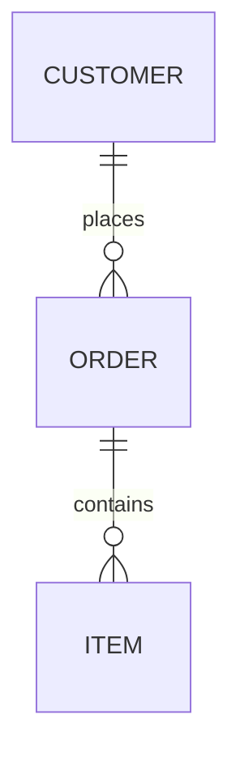

# Native Mermaid diagrams

The native engine provides a W parser, owned document model, lossless source writer,
source-edit API, deterministic layout, SVG exporter, CLI, and native desktop
editor with live preview and flowchart/ER/class/state canvas editing. It has no Mermaid JavaScript, Node,
browser, network, or external layout dependency. The desktop uses the existing
`graphics.ui` and native OpenGL stack. The library and CLI run on x86 and x64;
the desktop has Linux X11 workflow tests, screen-reader qualification against
real AT-SPI and headless Orca, Windows cross-compilation with Wine smoke,
save and UI Automation coverage, and macOS ARM64 cross-compilation. Native
Windows/macOS desktop qualification remains outstanding; the checklist for
real hardware is [mermaid_desktop_qualification.md](mermaid_desktop_qualification.md).

The family-coverage milestone is implemented: every authoring family in the
pinned Mermaid **12.2.0** registry has a bounded native core, including all five
C4 headers, all four railroad notations and agentflow. ZenUML is also supported.
The [compatibility matrix](mermaid_compatibility.md) lists every family, runnable
examples, implemented semantics and remaining gaps. This is **not full Mermaid
compatibility**: syntax, configuration, styling, layout and editing depth remain
incomplete.

Supported documents share read/write, source editing, native preview and SVG
export. Unsupported syntax produces a diagnostic and suppresses the preview;
the original document remains readable, editable as source, and saveable without
data loss. Markdown or HTML inside accepted plain labels is displayed literally.

## Use

```sh
./wbuild wmermaid wmermaid_editor
bin/wmermaid check examples/mermaid/orders.mmd
bin/wmermaid read examples/mermaid/orders.mmd
bin/wmermaid write examples/mermaid/orders.mmd bin/orders.mmd
bin/wmermaid svg bin/orders.mmd bin/orders.svg
bin/wmermaid_editor bin/orders.mmd
bin/wmermaid_editor examples/mermaid/classes.mmd
bin/wmermaid_editor examples/mermaid/states.mmd
```

`write` preserves the original bytes, including comments and CRLF. It is not a
formatter; `format` is (see "Canonical serialization and formatting" below). `edit INPUT START END REPLACEMENT_FILE OUTPUT` replaces the half-open
UTF-8 byte range `[START, END)` and writes the result; replacement text is read
literally from the file. Invalid intermediate syntax is allowed in source edits
and writes. Run `check` to validate, or `svg` to validate and export. Neither
command accepts an invalid document as a successful diagram. Diagnostics go to
stderr with one-based line/byte-column positions; failed commands exit nonzero.
SVG export validates before touching its destination.

The desktop opens the named source. Edit text on the left to update the preview.
The path field and **Open** load another file; **Save** saves the current file,
and **Save as** creates a new file at the path field (existing destinations are
refused). **Undo/Redo** retain 32 source snapshots; consecutive source typing is grouped
until a 500 ms pause or editing boundary. **Previous/Next diagram**
select a Mermaid fence while keeping the complete Markdown source editable.
The dynamic path field supports paths beyond the former 127-byte limit.

Graphical editing covers flowcharts, agentflow, ER, class (`classDiagram`), state
(`stateDiagram`, `stateDiagram-v2`), requirement, use case, architecture,
block, C4, swimlane, mindmap, treeView and kanban diagrams. Clicking a node or group
selects it and populates the inspector. **Apply** changes its displayed label
(or, with a connection selected, the connection label); **Delete** removes the
node and its incident connections, or a group with its members. Clicking a
connection selects it. Edits preserve unrelated source, comments, styles,
configuration and other Markdown fences; deleting edges also updates indexed
`linkStyle` assignments. Each graphical operation is one undo step, and failed
edits leave the document unchanged.

Every graphical edit is a source splice validated by reparsing: the result must
keep every other node (label, shape, members, annotation, attributes, scope,
styles), every other edge in order, the notes, class definitions, direction,
title and accessibility text, or nothing changes. `mm_editor_edit_reason`
returns the reason an operation is unavailable (empty when it is available).
Flowchart, ER, class and state edits first try the family's dedicated
rewrites below; every family then falls back to a generic engine
(`libs/extras/mermaid/edit_engine.w`) that proposes a few minimal candidate
splices (whole statements, single items within a row, a relation row reduced
to the declarations of its surviving endpoints, an in-place label, a label
inserted after the id) and commits the first one that validates. Commands that
touch several items (deleting a selection, a group with its members) run in an
`mm_editor_begin`/`mm_editor_commit` transaction, so they are one undo step and
roll back together.

A class or state whose only mention was a removed relationship is redeclared in
place (`class Leg~T~`, or a bare state `Idle`), so deleting a connection never
deletes its endpoints. Class deletions in diagrams with lollipop `()--`
interfaces stay source-edited, since their synthetic identities are positional;
so do synthetic containers (a block's root, concurrent state regions). Start,
end, choice, fork and join states have no editable label. Notes are not
selectable on the canvas; they follow their node and are deleted with it.

Groups (flowchart and swimlane `subgraph`, class `namespace`, composite
`state X { }`, use-case `systemBoundary`, C4 `*_Boundary`, architecture
`group`) are edited like nodes. Selecting a group and dragging or nudging it
moves its members with it; a member keeps its offset inside the group, and a
group grows to fit members moved or resized inside it. **Ungroup** (Ctrl+G)
removes only the opener and closer (or architecture ` in group` suffixes), so
the members join the parent scope. With a group id in the **Group** field,
**Into** moves the selected node into that group, **Out** moves it to the top
level and **Add in** adds a new node inside the group; the move carries a
declaration with its label and shape, or adds a bare mention before the
group's closer, and is refused when another statement inside the old group
would still declare the node there (an edge written inside a subgraph).

| Family | Move / resize | Groups | Rename | Delete | Add / Link to | Inspector |
| --- | --- | --- | --- | --- | --- | --- |
| Flowchart | nodes and subgraphs | subgraph move, rename, delete, ungroup, into/out, add in | in place, else `ID[label]` | chains, `style`/`class`/`linkStyle` targets | `ID["label"]`, `A --> B` | label; kind `-->`, `---`, `-.->`, `==>`, `--o`, `--x`, `<-->` |
| ER | entities | none | in place, else `ID[label]` | relationships; attributes stay with survivors | `ID["label"]`, `\|\|--\|{` | label; cardinality (1 to 1, 1 to 1+, 1 to 0+, 1+ to 1+; `mm_editor_er_cardinality` takes any pair); attributes add/remove/set |
| Class | classes and namespaces | namespace move, rename, delete, ungroup, into/out, add in | in place, else `class ID["label"]` | declaration/body, annotations, member lines, relationships, notes | `class ID["label"]`, `A --> B` | label; kind `-->`, `--`, `..>`, `..`, `<\|--`, `*--`, `o--`, `..\|>`; members add/remove/set |
| State | states and composites | composite move, rename (`ID : label`), delete, into/out, add in | `ID : label` | transitions, descriptions, notes, orphaned `[*]` | `ID : label`, `A --> B`, `[*]` | transition label |
| Requirement | requirements and elements | none | refused (labels are identifiers) | its block and relations | `requirement ID {}`, `A - traces -> B` | relation keyword; properties add/remove/set |
| Use case | actors, use cases, boundaries | `systemBoundary` move, rename, delete, into/out, add in | in place | its statements | `ID(label)`, `A --> B` | label (`-- "label" -->`); kind `-->`, `---`, `..>` |
| Architecture | services, junctions, groups | group move, rename, delete, ungroup, into/out (` in group`), add in | in place | its statements | `service ID(server)[label]`, `A:R --> L:B` | none (edit sides in source) |
| Agentflow | nodes and `flow` containers | `flow` move, rename, delete, ungroup, into/out, add in | in place | its statements | `ID["label"]`, `A --> B` | label; kind `-->`, `---`, `-.->`, `-.-`, `==>`, `--x` |
| Block | cell order (a move swaps source items; a selection moves as a run); resize sets the column span `ID:N` or `block:ID:N` | none | in place | the item, keeping the rest of its row | `ID["label"]`, `A --> B` | label; flowchart kinds |
| C4 | cards and boundaries | boundary move, rename, delete, into/out, add in | in place | its statements | `System(ID, "label")`, `Rel(A, B, "Uses")` | relation label |
| Swimlane | steps and lanes | lane move, rename, delete, into/out, add in | in place | its statements | `ID["label"]`, `A --> B` | label; flowchart kinds |
| Mindmap / treeView | sibling order; a drop on another node moves the branch under it; a selection moves together | n/a | in place (glyphs and `##` notes kept) | the subtree (the mindmap root is refused) | **Add child**, **Add sibling** | **Up** / **Down** reorder among siblings |
| Kanban | card order in a column; cards move between columns (drop, Left/Right, **Previous**/**Next**); a selection moves together | n/a | in place (metadata kept) | the card or column with its cards | **Add child** (a card), **Add sibling** | **Up** / **Down** reorder |

C4 and swimlane geometry is stored like a flowchart's: the family's own
layout runs first, then the saved `@w-position` and `@w-size` records
apply (a boundary or lane carries its members and grows to keep them).
Block, mindmap, treeView and kanban layouts are their source order, as in
upstream Mermaid, so a move never stores coordinates: dragging shows the
item following the pointer and the drop reorders the source. A block
dropped on another cell of its composite takes that cell's place (adjacent
items swap one validated splice at a time; a composite `block:id ... end`
moves as whole lines), arrows move it one cell (Up/Down by a row of the
composite's `columns`), and the resize handle or Alt+Left/Right sets its
column span (`ID:N`, or `block:ID:N` for a named composite, which must fit
the parent's columns; 1 drops the suffix). Outline nodes move among
their siblings with the arrows or a drop on a sibling; a drop on another
node moves the branch under it as its last child, re-indented under that
node. A kanban card dropped on a column becomes its last card, dropped on a
card lands before it, and Left/Right move it to the neighbouring column.

A multi-selection in these families moves as one validated transaction (one
undo step; any refused step rolls the whole move back), and the moved items
keep their source order. An item inside another selected item (a card of a
selected column, a branch under a selected branch, a composite's member)
rides along with it. Selected siblings dropped on a sibling move as one
contiguous run that takes the target's place: after the target when it
follows the dragged item, before it otherwise (block cells of one
composite, outline siblings, cards of one column, kanban columns). Outline
items dropped on a node of another branch become that node's last children;
kanban cards dropped on another column become its last cards, and dropped on
a card of another column land before that card. Arrow keys shift every
selected sibling by one slot (a block row with Up/Down), keeping the gaps
between them, and are refused at the edge; Left/Right move the selected cards
of one column to the neighbouring column. Block cells of different
composites, a kanban column selected with cards of another column, and a drop
on a selected item (or inside one) are refused. The selection follows the
moved items.

GitGraph, event modeling and the other families stay source-edited on
purpose: a gitGraph is a command script whose commits, branches and lanes
come from executing it in order, so moving or deleting a commit would
rewrite history semantics rather than a diagram element; event-modeling
columns are its numbered time frames and its lanes are typed by entity
kind, so a position is the model itself; data charts, sequence-like and
grammar families have no node-aligned scene.

Drag a node or group to reposition it; edges follow live. Release commits one
undo step, while Escape restores the starting position. Small pointer jitter
selects without moving. **Move here** followed by a destination click provides
a non-drag alternative. Arrow keys move the selection by one layout pixel,
or ten with Shift. Background dragging pans the view. Wheel zoom stays anchored
under the pointer, **Fit** centers the diagram, and edits retain the camera.
**Auto layout** clears the selected diagram's saved positions and sizes in one
undoable action and fits the result. The source/canvas divider is resizable.

Shift-, Ctrl- or Cmd-click toggles a node in the selection, and a Shift-drag
from the background draws a rubber band that adds what it touches. From the
keyboard, Space toggles the focused item and keeps extending while Tab moves
the focus, and Ctrl+A selects every node and group. Dragging any selected
item, or an arrow key, moves the whole selection as one undo step (a member
whose group is also selected rides with the group); Delete removes the whole
selection as one step. A plain click on a selected item selects just it.

A single selected node or group shows a handle at its bottom-right corner;
dragging it, or Alt+arrows, resizes it. The size is stored next to positions
as a standalone `%% @w-size "ID" W H` comment (minimum 8, maximum 20000
layout pixels) that the renderer, SVG export and reopen apply after layout,
like `%% @w-position`; for a group the size is a minimum that still grows to
fit its members.

**Add** creates a node from the inspector fields with the family's template
(table above). **Link to** then a destination click adds the family's default
connection. With a connection selected, the **Kind** row offers the family's
connectors (ER: cardinalities), each replacing only the operator, and
**Apply** edits, adds or (empty) removes its label. With a class, entity or
requirement selected, the compartment row adds a member, attribute
(`type name [keys]`) or property line inside the body block and removes the
last one; `mm_editor_member_set`/`mm_editor_attribute_set` rewrite a line in
place. The **Line** row (Ctrl+P, then Ctrl+P again for the next line, or
**<** / **>**) shows one existing line (an ER attribute as
`type name [keys] ["comment"]`) and edits it in place as you type
(`mm_editor_line_set`): each keystroke that leaves a valid line is a
validated splice, a typing run within 500 ms is one undo step
(`mm_editor_coalesce`; a saved state stays a stop), and an invalid
intermediate text is not applied. Outline families use **Add child**, **Add sibling**, **Up** and
**Down** with the label field's text.
**SVG** writes `CURRENT_FILE.svg` using the saved manual positions too.

| Shortcut | Action |
| --- | --- |
| Ctrl+S | Save |
| Ctrl+Z / Ctrl+Shift+Z / Ctrl+Y | Undo / redo / redo |
| Ctrl+D / Ctrl+E / Ctrl+L / Ctrl+R | Focus canvas / source / path / label |
| Ctrl+Enter, with label focus | Apply the selected node's label |
| Ctrl+N | Start adding a new node/entity |
| Ctrl+P | Edit the selected class member, property or attribute line; again: the next line |
| Tab / Shift+Tab, with canvas focus | Select next / previous node or group |
| Space, with canvas focus | Toggle the focused item in the selection; Tab then keeps the selection |
| Ctrl+A, with canvas focus | Select every node and group |
| Shift/Ctrl+click, Shift+drag on the background | Toggle a node / rubber-band select |
| Arrows / Shift+arrows, with canvas focus | Move the selection 1 / 10 pixels |
| Alt+arrows / Alt+Shift+arrows, with canvas focus | Resize the selected node or group 1 / 10 pixels (a block: Alt+Left/Right change its column span) |
| Delete, with canvas focus | Delete the selection or the selected connection |
| Ctrl+G, with canvas focus | Ungroup the selected group |
| Escape | Cancel a drag, placement, connection or close prompt |
| Ctrl+0 / Ctrl+plus / Ctrl+minus | Fit / zoom in / zoom out |
| Ctrl+Q | Close with the unsaved-change prompt |
| Ctrl+K, after a disk change | Keep mine: the next save replaces the changed (or recreates the deleted) file |
| Ctrl+Shift+R, after a disk change | Reload from disk, discarding the editor's changes |

Canvas navigation and Delete are scoped to canvas focus, so editing text does
not delete diagram objects. Command chords are also accepted where the native
backend reports them. Controls for unsupported operations are disabled.
The interaction choices follow [W3C's non-drag alternative guidance](https://www.w3.org/WAI/WCAG22/Understanding/dragging-movements)
and [GNOME's guidance on reversible actions](https://developer.gnome.org/hig/principles).

### Screen readers

The canvas is exposed through the toolkit's semantic snapshots
(`graphics/mermaid_access.w`, [accessibility.md](accessibility.md)) next to the
widgets' own semantics. The canvas is a list named "Diagram canvas" (plus the
diagram's title), described by its family, node/group/edge counts, any
`accDescr` text and the keyboard model. Each node, group and edge is an item:

| Item | Role | Name | Description | States / actions |
| --- | --- | --- | --- | --- |
| Node | list item | its label (its id when unlabeled) | `node B in Shop, 1 outgoing, 1 incoming, movable` | focusable, selected; focus and select (activate) select it |
| Group | group | its label | `group S containing 3 items` | focusable, selected; focus and select select it (as with Tab) |
| Edge | list item | `Alpha to Beta: pays` | `edge from Alpha to Beta, label pays, dashed` | focusable, selected; focus and select select it |

Bounds are window coordinates of the node boxes (an edge spans its endpoint
centers) and follow zoom and pan. While the canvas has keyboard focus, the
selected item is the focused accessible object, so Tab/Shift+Tab, arrows and
Delete produce focus, selection, state and children-changed events that a
screen reader announces. Assistive focus or selection (Orca, AT-SPI
`GrabFocus`/`SelectChild`, UIA `SetFocus`/`SelectionItem.Select`) selects the
item on the next frame and moves keyboard focus to the canvas. With a
multi-selection every member carries the selected state and the focused item
is the focused object; assistive select replaces the selection. The status line
is a text object. Families whose scene does not line up with document nodes
(pie, sequence, Gantt, ...) expose the canvas summary only. At most 2,048
items are listed; the summary says when more exist.

The editor publishes through `graphics/__arch__/*/access_platform.w`: AT-SPI 2
on Linux (only when an accessibility bus is running; otherwise nothing is
built per frame), UI Automation on Windows, and NSAccessibility on macOS when
built with the opt-in companion (see the qualification document; the default
Mach-O has no bridge, because the companion dylib must ship beside it).

`mermaid_canvas_access_test` (in `tests`) checks the snapshot: roles, names,
descriptions, bounds under zoom/pan, selected/focused state, assistive
requests reaching the selection, and the canvas-only case.
`mermaid_canvas_uia_test` (in `tests_win64`, under wine) reads the canvas
through wine's UI Automation client, selects an edge through SelectionItem
and receives the focus-changed event. Two opt-in targets run the real editor
headless under Xvfb with at-spi2-core:

```sh
apt-get install xvfb at-spi2-core python3-pyatspi gir1.2-atspi-2.0   # + orca speech-dispatcher
./wbuild mermaid_editor_atspi_test   # libatspi client: tree, extents, hit test, GrabFocus,
                                     # SelectChild, Tab/Shift+Tab/Delete/Ctrl+Z events
./wbuild mermaid_editor_orca_test    # the same with Orca speaking through the dummy module
```

Both fail rather than skip when a dependency is missing. Qualified here
(Ubuntu 24.04, at-spi2-core 2.52, Orca 46.1): Orca announces the window frame,
"Diagram canvas. List with 5 items." on entering the canvas, then each node or
edge by name with its description ("Beta. node B, 1 outgoing, 1 incoming,
movable.") as GrabFocus, SelectChild, Tab and Shift+Tab move focus. Orca
suppresses an edge's description when it repeats the name. Not exercised:
braille, Orca's flat review and structural navigation commands, and
Narrator, NVDA and VoiceOver (native runs pending). This is not a claim of
full accessibility conformance.

Manual positions use ordinary comments such as `%% @w-position "A" 100 120`
inside the selected diagram. Coordinates are nonnegative layout pixels bounded
at 100,000 per axis, before the title gutter. Only real comment statements are
interpreted; similar text in labels or accessibility descriptions is not metadata.
Other Mermaid implementations ignore these comments and use their own layout.
Lossless save/reopen retains positions; canonical output deliberately discards
comments, including these position hints.

The editor asks to save/discard/cancel on close with unsaved changes. Opening
another file requires saving changes first. Save failure preserves editor dirty
state. Errors clear the preview while leaving the original text editable and
saveable.

### Disk changes and concurrent writers

The editor keeps the exact bytes it last read or wrote as its baseline and never
overwrites anything else. It polls the file four times a second by a
size/mtime/ctime/inode fingerprint and compares bytes whenever the fingerprint
moves and every two seconds regardless (same-second, same-size in-place
rewrites; Windows has no fingerprint, so it always compares bytes). A change
shows **Changed on disk: Reload from disk / Keep mine** (or **Deleted on disk**)
and the status line says what each does; Ctrl+Shift+R and Ctrl+K do the same
from the keyboard. Until one is chosen, Save refuses with a conflict message
and the editor stays dirty. **Keep mine** adopts the current disk version (or
its absence) as the baseline, so the next save replaces exactly that version;
**Reload from disk** replaces the editor's text and history. The older
**Reload** button keeps its discard confirmation.

Saving is a compare-and-swap (`libs/extras/mermaid/save_guard.w`;
`mm_editor_save_checked` returns `MM_SAVE_OK`, `MM_SAVE_CONFLICT` or
`MM_SAVE_FAILED`):

1. Compare the disk bytes with the baseline; any difference is a conflict.
2. Stage the new bytes in a fresh same-directory temp file (exclusive create,
   fsync, close), keeping the old file's permission bits.
3. Claim the current file by renaming it to a same-directory claim name, and
   compare the claimed bytes with the baseline again. A writer that replaced
   the file after step 1 is caught here; its file is linked back unchanged.
4. Place the temp file with a no-replace `link(2)` (Windows: `MoveFile`, which
   never replaces). A writer that created the path after the claim makes this
   fail: its file stays, the claim (the baseline) is dropped, conflict.
5. Re-check the claimed copy before deleting it. A program that still held the
   old file open and wrote into it after step 3 leaves different bytes there;
   they are kept as `FILE.claim.<pid>.<n>` and the save reports a conflict
   naming that recovery file. Then fsync the directory (not on Windows).

So no writer that completes before the claim, or creates the path after it, is
lost or silently overwritten. Remaining limits: readers can see the path absent
for the instant between claim and placement; a filesystem without hard links
falls back to an exclusive copy (still no-replace, not atomic for readers); on
Windows, temp names are unique per process rather than created with `O_EXCL`,
and another program's open without delete sharing makes the claim fail
(reported as a save failure). A symlink at the path is replaced by a regular
file, as before. Save As shares the exclusive writer and refuses existing
destinations. `save_guard_test` (x86, x64 and a win64 twin under wine) injects
a writer at each stage (`mm_save_race_hook`) and checks that nothing is
overwritten and no temp or claim file is left behind.

`--diagram N` selects a zero-based Mermaid fence in CLI check/read/write/edit/svg,
canonical and format operations (default 0). Read/write/edit preserve the complete
source; check/svg/canonical/format operate on the selected diagram.

### Canonical serialization and formatting

```sh
bin/wmermaid format INPUT              # canonical source on stdout
bin/wmermaid format INPUT -o OUTPUT    # ... written durably to OUTPUT
bin/wmermaid format --check INPUT      # exit 1 if INPUT is not canonical
bin/wmermaid canonical INPUT OUTPUT    # same as format INPUT -o OUTPUT
```

`format` rebuilds the selected diagram from its semantic model: frontmatter
(title, theme, themeVariables, layout, look, spacing and family keys), the
family header, accessibility lines, declarations, relationships, class
definitions and styles, in one consistent layout (one statement per line,
explicit quoted labels, nested blocks indented). It works for all 33 families.
Comments, position-hint comments, blank lines and the original spelling of
equivalent syntax are dropped; Markdown around a fence is not written, so
formatting a `.md` input yields the standalone diagram. `--check` compares the
selected diagram's own text (inside its fence, frontmatter included) with the
canonical form and writes nothing. A parse error, or a model with no exact
canonical source, fails with a diagnostic and leaves OUTPUT untouched. The
lossless `write`/`mm_save` path is unchanged and stays the save default.

The serializer never approximates: every emitted text is reparsed and compared
with the original model (`mm_document_diff`, semantic fields only, in index
order: node/edge/event order, labels, shapes, styles, configuration), and a
remaining difference makes the result null. One serializer file per family group
(`serialize_flow.w`, `serialize_uml.w`, `serialize_narrative.w`,
`serialize_data.w`, `serialize_c4.w`, ...) is dispatched from `serialize.w`;
`serialize_common.w` holds frontmatter, quoting and style helpers, and
`serialize_equal.w` the model comparison. `serialize_roundtrip_test` formats every
`examples/mermaid` diagram and every parsing-corpus manifest entry, asserts that
the reparsed model is equal and that formatting is idempotent, and keeps a
known-failure list with reasons (currently empty) that fails both when a listed
family starts passing and when an unlisted one fails.

For a reproducible native preview on a headless Linux host with Xvfb:

```sh
xvfb-run -a bin/wmermaid_editor examples/mermaid/orders.mmd \
  --frames 3 --screenshot bin/mermaid.ppm
bin/ppm_to_png bin/mermaid.ppm bin/mermaid.png
```

## Desktop validation by platform

| Platform | Checked here | Still needed |
| --- | --- | --- |
| Linux x64 / X11 | Real pointer/key workflows under Xvfb (flowchart pointer editing; keyboard-only edit, undo and redo chains in ER, class and state; external change, Keep mine, reload, deletion); AT-SPI and headless Orca screen-reader runs; screenshot/export and save/reopen | Physical display, input-method, braille and HiDPI checks |
| Windows x64 / WGL | PE cross-compile; Wine/Xvfb startup/render/screenshot smoke; compare-and-swap saves under wine; canvas semantics through wine's UI Automation client | Native run pending: input, clipboard, DPI scaling, NTFS/OneDrive saves, Narrator/NVDA |
| macOS ARM64 / Cocoa | Mach-O cross-compile, with and without the NSAccessibility companion | Native run pending: input, clipboard, Retina scaling, APFS/iCloud saves, VoiceOver |

`./wbuild mermaid_editor_platforms` cross-compiles the desktop binaries
(including `bin/wmermaid_editor_darwin_voiceover`) and is part of the full
suite. `./wbuild mermaid_editor_ui_test` runs the Linux workflows
and requires Xvfb plus the X11/XTest shared libraries. It fails if the display or
editor cannot start; it does not silently count a skipped GUI run as a pass.
The normal suite also includes display-independent canvas, edit-command and
position-persistence tests on x86/x64.

```sh
# Windows smoke on a Linux host with Wine and Xvfb; use an isolated Wine prefix.
xvfb-run -a env WINEPREFIX="$PWD/bin/mermaid-wine-prefix" WINEARCH=win64 \
  wine bin/wmermaid_editor_win.exe examples/mermaid/build.mmd \
  --frames 3 --screenshot bin/mermaid-windows.ppm
# Execute on an Apple Silicon Mac after cross-compiling:
bin/wmermaid_editor_darwin examples/mermaid/build.mmd --frames 3 \
  --screenshot bin/mermaid-macos.ppm
```

## Flowchart and ER compatibility

Syntax references: [Mermaid flowcharts](https://mermaid.js.org/syntax/flowchart.html)
and [Mermaid ER diagrams](https://mermaid.js.org/syntax/entityRelationshipDiagram.html).
These describe upstream syntax; the table below defines the implemented subset.

| Area | Implemented |
| --- | --- |
| Input | Raw UTF-8 `.mmd` source or a selected Mermaid Markdown fence, BOM, LF/CRLF, `%%` comments, semicolon separators |
| Flow header | `flowchart` or `graph`, followed by `TB`, `TD`, `BT`, `LR`, or `RL` |
| Flow nodes | Bare IDs, rectangle `[label]`, rounded `(label)`, circle `((label))`, double circle `(((label)))`, diamond `{label}`, stadium `([label])`, subroutine `[[label]]`, cylinder `[(label)]`, asymmetric `>label]`, hexagon `{{label}}`, parallelograms and trapezoids; quoted labels; `A@{ shape: ..., label: ... }` metadata with every Mermaid 12.2 shape name and alias (documents, stacked/lined/divided/tagged rectangles, braces, forks, flags, bolts, hourglass, ...), `icon`/`img` placeholders and `w`/`h`/`pos`/`constraint` |
| Flow edges | `-->`, `---`, `-.->`, `==>`, `<-->`, `o--o`, `x--x`, invisible `~~~`, extended lengths (up to 16), `-- text -->` and `|label|`, `&` groups, chains, cycles, self edges; edge IDs `e1@-->` with `e1@{ animate: true, curve: linear }` |
| Interaction | `click ID href "url" "tooltip" _blank`, `click ID "url"`, `click ID call fn()` and bare callbacks; links render as SVG `<a>` only for relative, fragment, http(s) and mailto URLs, callbacks are kept in the model and never run |
| ER entities | Bare/quoted names, standalone entities, `[alias]`, attribute blocks |
| ER attributes | `type name`, `PK`/`FK`/`UK` and comma-separated combinations, quoted comments, array/parenthesized/nullable types, `*` primary-key name spelling |
| ER relationships | All 16 symbolic cardinality combinations plus textual aliases (`only one`, `zero or many`, etc.); `--` / `to` identifying and `..` / `optionally to` non-identifying; required `: label` |
| Grouping | Nested `subgraph ID[label] ... end` in flowcharts and ER; scoped directions and compound bounds |
| ER direction | `direction TB`, `BT`, `LR`, or `RL` |
| Rendering | Entity attribute rows, relationship text, crow's feet, optional circles, one bars, dashed/solid edges; shared scene for native and SVG output |

Attributes occupy separate lines (or one attribute before a closing brace).
Labels support `<br>` line breaks, multi-line Markdown strings with
`**bold**`/`*italic*` emphasis and wrapping at 200px; other HTML, Mermaid entity
escape codes and rich labels are shown literally (see
[Text layout](mermaid_text.md)). Native glyph coverage follows the UI font
system; SVG uses a matching sans-serif face, and graph labels are measured with
the native preview's per-glyph widths.
ER attributes show type, name, keys and comment in each row rather than separate
resizable columns. Layout uses longest-path ranks with deterministic cycle
breaking and rank promotion, dummy-node chains for edges spanning several
ranks, barycenter sweeps with adjacent transposition and sifting (keeping the
order with the fewest crossings),
neighbor-aligned coordinates, channel routing between ranks and orthogonal
connectors by default. Edges never pass through unrelated node boxes (unless a
persisted position moves one endpoint, which drops that edge's channel route),
ER relationships spread along entity sides in the order of their far ends,
parallel flow edges take distinct ports in the same order, drawn crossings
equal the rank-to-rank crossings of the chosen order, and edge labels move off
nodes and earlier labels. It is not upstream Dagre/ELK; see [Layered layout and routing](mermaid_layout.md)
for the algorithm, budgets and measured before/after quality.

Node styles/classes and a bounded frontmatter theme subset are implemented;
see [Styles and themes](mermaid_styling.md). Remaining gaps include
most configuration options, icon packs and remote images (shown as placeholders),
Font Awesome names outside the built-in pictogram table and other rich text. Class and state coverage is listed below; other families are listed in the
[compatibility matrix](mermaid_compatibility.md).

## Native graph layout selection

The default layered layout also accepts frontmatter `config.layout: dagre` as
an input alias; this selects the W implementation, not the upstream Dagre engine.
The native extension `config.layout: force` selects deterministic force-directed
placement for flow, ER, class, state, requirement, C4, architecture, use-case and
agentflow graphs. Each group is laid out independently and sized around its
children. Fixed iteration budgets and a final collision pass keep sibling boxes
disjoint and repeated exports reproducible. Force layout keeps direct
connectors (no channel routes) and the general 1,024-node budget because each
round is quadratic. Unsupported layout names and force layout on other families
are diagnosed rather than silently ignored.



## Class and state compatibility

The UML syntax baseline is pinned to Mermaid **12.2.0**:
[class syntax](https://github.com/mermaid-js/mermaid/blob/mermaid%4012.2.0/packages/mermaid/src/docs/syntax/classDiagram.md),
[state syntax](https://github.com/mermaid-js/mermaid/blob/mermaid%4012.2.0/packages/mermaid/src/docs/syntax/stateDiagram.md).
This is subset coverage, not a claim of upstream rendering or syntax parity.

| Family | Implemented |
| --- | --- |
| Class declarations | `classDiagram`, `class ID`, `class ID["label"]`, member blocks, `ID : member`, `<<annotation>>` in blocks, before IDs, or after declarations |
| Class members | Literal visibility/type/signature text, separated into attribute and operation compartments by the presence of `(`; input order is retained within each compartment |
| Class relationships | Solid `--` and dashed `..`; optional open arrow, hollow triangle, filled composition diamond or hollow aggregation diamond at either end; quoted multiplicities and `: label` |
| Class grouping | Nested `namespace Name { ... }`, globally unique class IDs, relations across namespaces, declarations that assign previously referenced classes to their namespace |
| State declarations | `stateDiagram` / `stateDiagram-v2`, bare IDs, `state "label" as ID`, `ID : description` |
| State transitions | `-->`, optional `: label`, cycles/self transitions, scope-local `[*]` initial and final nodes |
| State structures | Nested `state ID { ... }`, transitions to/from composites, `<<choice>>`, `<<fork>>`, `<<join>>` |
| Direction | Top-level and group-local `direction TB`, `TD`, `BT`, `LR`, `RL`; children inherit their containing group's direction |
| Output and editing | Shared native/SVG geometry, lossless read/write and source edits, editor preview/history/save and canvas editing (select, drag, resize, rename, delete, add, link, member edits) for both families, including namespaces and composite states |

Groups reserve space for their children before the containing graph is laid out.
Namespaces render as labeled containers; composite states render with their own
initial/final nodes. Class relationships retain separate endpoint types and
multiplicity labels. Class names remain globally unique; state transitions across
scopes route through their nearest common containing group. A group may contain at most 32 nested group levels. Class members
share the 4,096-document / 1,024-node attribute budget.

Class declarations additionally support nested generic parameters, backtick IDs,
dotted namespaces with labels, unique lollipop interfaces and notes. State
transitions support forward declarations across composite boundaries, plus
left/right multiline notes. See [UML additions and limits](mermaid_uml.md) for
exact identity, ownership and placement rules.

Concurrent `--` state regions, comma-separated generic parameters and
Markdown-string labels are supported; HTML labels and full configuration are
not. Node styles/classes,
accessibility statements and class `link`/`click`/`callback` statements (safe
SVG links and tooltips) are supported. Members display with `~T~` generics as
`<T>`, methods as `name(params) : Return`, `$` static members underlined and
`*` abstract members in italics; annotations display literally. Unsupported
structures fail parsing and clear the preview while preserving editable source.
Automatic routing can still overlap connectors or labels across boundaries.

## Markdown, titles and accessibility

A source document can contain multiple backtick or tilde Mermaid fences. The
parser ignores other-language fences, defaults to the first Mermaid diagram,
and preserves all surrounding prose and line endings. Select another diagram
with `mm_parse_selected`, CLI `--diagram N`, or the editor's previous/next buttons.
Out-of-range selections and unterminated fences produce diagnostics. Parse
locations and byte-range edits refer to the original complete source; immutable
edits retain the selected diagram index. See `examples/mermaid/document.md`.

Plain `title:` frontmatter is supported at the beginning of a raw diagram or
inside the selected fence. Quoted scalar
titles are accepted. The frontmatter parser also accepts the bounded `config`
theme subset described in [Styles and themes](mermaid_styling.md); it is not a
general YAML parser: lists, block scalars, escapes and anchors are read
([config reference](mermaid_config.md)), YAML tags are rejected, and
unknown configuration keys are ignored and recorded.

`accTitle:` and `accDescr:` (including brace-delimited multiline descriptions)
provide escaped SVG title/description metadata across families, including the
indentation-based mindmap, Kanban, TreeView and Ishikawa parsers. Metadata does
not alter hierarchy indentation. Frontmatter titles are visible in native preview
across families. Source edits preserve metadata.

## Styles and themes

Flowchart, ER, class and state diagrams support node `style`, `classDef` and class
assignment, with fill, border/text colors and integer stroke widths. Styles
resolve consistently into native and SVG primitives, including transparent fills.
The five frontmatter theme names `default`, `base`, `dark`, `forest` and `neutral`
select native palettes. With `base`, six quoted-hex `themeVariables` are supported.
[The styling reference](mermaid_styling.md) defines precedence, accepted names,
limits and exact indentation. This does not provide general CSS, upstream theme
parity, font overrides or arbitrary diagram configuration.

## W library

```w
import libs.extras.mermaid.parser
import libs.extras.mermaid.render

char* source = c"erDiagram\nCUSTOMER ||--o{ ORDER : places\n"
mm_document* doc = mm_parse(source, strlen(source))
if (doc.error == 0):
	mm_scene* scene = mm_render(doc)
	char* svg = mm_svg(scene)
	# Consume svg here; it is owned by the caller.
	free(svg)
	mm_scene_free(scene)
mm_document_free(doc)
```

- `model`: `mm_document`, nodes, attributes and edges; `mm_write(doc)` returns
  owned source text; `mm_document_free` frees the complete document.
- `source`: lossless Markdown/frontmatter envelopes and original-document offsets.
- `scene`: owned backend-independent primitives and escaped SVG metadata.
- `parse_common` / `uml`: bounded lexical helpers and class/state parsers.
- Family modules: graph/workflow parsers and layouts, `data_parse` / `data_render`,
  narrative parsers/renderers, `railroad_parse` / `railroad_render`, and `agentflow`.
  Their owned models preserve family-specific semantics.
- `style` / `style_render`: bounded style parsing, resolution and scene palettes.
- `parser`: `mm_parse(bytes, length)` copies input and returns an owned result,
  including failures. `error == 0` means successful subset parsing.
  `mm_edit(doc, start, end, replacement, length)` returns an independent reparsed
  document; null means invalid range/budget or a split UTF-8 codepoint. The old
  document is unchanged. Fields are inspectable; edit source and reparse to keep
  the model and lossless writer consistent. `mm_write` always returns original bytes.
  `mm_parse_selected(bytes, length, index)` selects a zero-based Markdown diagram.
- `serialize`: `mm_serialize(doc)` returns canonical standalone source for any
  family from the model, or null if the model cannot be represented without
  dropping semantics; `mm_serialize_explain(doc, &diff)` also returns the first
  model difference. `mm_format(bytes, length)` parses and serializes in one call.
  `mm_document_equal(a, b)` / `mm_document_diff(a, b)` compare semantic models.
- `render`: `mm_render(doc)` returns an owned display list, or null for a failed
  parse; `mm_svg(scene)` returns owned escaped XML. `mm_scene_free` releases it.
- `io`: `mm_read(path)` returns an owned document, or null for I/O/budget failure;
  `mm_save(doc, path, io_result*)` returns an `IO_*` status. `mm_diagnostic` returns
  an owned location/message string.
- `editor`: UI-independent source history, diagram selection, structured flowchart
  additions, hit testing, dirty state, disk polling (`mm_editor_poll`), Keep mine,
  reload, compare-and-swap save (`mm_editor_save_checked`) and gesture state:
  set moves (`mm_editor_move_begin_set`, `mm_editor_move_nodes`), resizing
  (`mm_editor_resize_node`) and `mm_editor_begin`/`commit`/`rollback`
  transactions that make several commands one undo step.
- `save_guard`: disk fingerprints and comparison, and the compare-and-swap save.
- `edit_commands`: transactional label/delete commands for every graphically
  editable family, `mm_editor_edit_reason`, additions (`mm_editor_add_graph_node`,
  `mm_editor_add_node_in`), connections (`mm_editor_connect`), group commands
  (`mm_editor_ungroup`, `mm_editor_reparent`, `mm_editor_delete_nodes`) and
  inspector commands (`mm_editor_edge_label`, `mm_editor_edge_kind`,
  `mm_editor_er_cardinality`, `mm_editor_attribute_*`, `mm_editor_member_*`).
- `edit_engine`: the generic validated splice engine those commands fall back to.
- `edit_outline`: mindmap/treeView rename, delete, add child/sibling and reorder.
- `edit_slots`: source-order moves (block cells, outline siblings and branches,
  kanban cards: `mm_editor_slot_step`, `mm_editor_slot_move`,
  `mm_editor_slot_column`), their multi-selection forms
  (`mm_editor_slot_move_set`, `mm_editor_slot_step_set`,
  `mm_editor_slot_column_set`; moved indices in `mm_slot_moved_set`) and block
  column spans (`mm_editor_block_span`).
- `positions`: bounded source position and size hints (`@w-position`, `@w-size`)
  applied after layout, outermost group first, before rendering connections.
- `canvas`: display-independent selection (single, multi-selection, rubber band),
  movement, resizing, navigation and connection state.
- `graphics.mermaid`: `mm_ui_render` draws a scene into a clipped viewport with
  zoom and pan using an existing `ui_renderer`.
- `graphics.mermaid_access`: `mm_access_canvas` adds the canvas semantics to a
  snapshot; `mm_access_apply` applies assistive focus/select requests.

The shared source limit is 1 MiB. Flowchart and ER documents permit at most
4,096 nodes and 8,192 edges (ER attributes: 1,024 per entity, 16,384 per
document); the other graph documents keep 1,024 nodes and 1,024 edges, and
attributes/members have 1,024-per-node and 4,096-document budgets. Force layout
is limited to 1,024 nodes. The measurements behind these budgets are in
[Layered layout and routing](mermaid_layout.md). Common graph/container nesting is capped at 32 levels. Some families
have different limits: hierarchy depth, data values/entries, railroad expressions
and metadata budgets are specified in their linked references. Parsing rejects
invalid UTF-8, embedded NUL and non-whitespace ASCII controls. Source bytes remain
available on syntax failure. A scene owns its strings and geometry independently
of the document. Callers own every returned object/string and must free them.

## Delivered stages and remaining work

Native core coverage is delivered for the foundation/UML families, fourteen
additional graph and workflow families, five ordered narrative families, eight
data families, railroad's four notations and agentflow. Markdown source envelopes,
titles, accessibility metadata and bounded styles/themes are also delivered.
See the [pinned inventory and per-family matrix](mermaid_compatibility.md) for the
precise boundary of each implementation.

Remaining compatibility and editing work:

1. Close the syntax and semantic gaps listed for each family, including advanced
   scheduling, grammar operators, compound graph constructs and richer metadata.
2. Expand theme/configuration compatibility, style coverage across families,
   links, fonts and rich labels without losing the native engine constraint.
3. Improve text measurement, wrapping, edge routing, port placement and dense
   chart layout. Native geometry does not reproduce Dagre/ELK or browser layout.
4. Extend graphical editing to the families still edited as source
   (sequence, Gantt, gitGraph, event modeling, ...) and to notes, lollipop
   interfaces and architecture edge sides ([per-family table](#use)).
   Use editor commands to keep source/history synchronized; mutating the AST
   directly still does not update the lossless writer.
5. Run the native Windows/macOS qualification
   ([checklist](mermaid_desktop_qualification.md)): Narrator/NVDA/VoiceOver,
   input, DPI/Retina and filesystem behavior. Accessible editing of labels on
   the canvas itself and spoken announcements of edit results
   (live regions) are not provided yet.
6. Expand the pinned upstream conformance corpus, malformed-input fuzzing and
   cross-family integration tests before claiming syntax or rendering parity.

Examples of the follow-up features:

- [Force-directed ER relationships](../../examples/mermaid/force-orders.mmd)
- [Vertical GitGraph with a cherry-pick](../../examples/mermaid/git-backport.mmd)
- [Descending 16-bit packet rows](../../examples/mermaid/packet-register.mmd)
- [Generic classes, interfaces and notes](../../examples/mermaid/uml-notes.mmd)

## Validation

`mermaid_test` and `mermaid_64_test` exercise parsing, every ER cardinality pair,
source round trips, immutable edits, failures, bounds, XML escaping, direction,
cycles and shared-child ranking. `mermaid_editor_test` covers undo/redo, dirty
state, failed saves, history bounds and clipped native drawing without a display.
`mermaid_cli_test` exercises executable exit codes, lossless and in-place file
writes, edits, invalid source preservation and well-formed XML.
`uml_test` and `uml_64_test` cover endpoint combinations, member compartments,
namespace ownership, compound bounds, scoped initial/final states, directions,
source edits, unsupported syntax and nesting/member limits. The native editor
tests also verify clipping for UML polygons and compound diagrams.
`compatibility_test` and `compatibility_64_test` cover compound flow/ER layouts,
all textual ER alias combinations, source envelopes, diagnostic offsets, source
edits and accessible SVG metadata.
Family targets include `graph_families_test`, `framework_test`, `gitgraph_test`,
`blocks_test`, `systems_test`, `c4_test`, `workflows_test`, `data_test`,
`narrative_test`, `railroad_test` and `agentflow_test`, with their x64 twins.
`style_test`, `style_64_test` and `mermaid_style_native_test` verify palette/style
resolution, transparent fills and native/SVG parity. Tests cover family semantics,
layout bounds, source ownership, byte-prefix truncations and malformed edits.
The examples support CLI check/export and headless native preview checks.
These source-owned targets join `./wbuild tests` automatically. Passing these
checks establishes the documented subsets, not full upstream conformance.

The #706 follow-up tests add canonical model serialization, selected Markdown
edits, stale-file save guards, native concave-polygon filling, force-layout
repeatability/collision checks, layered crossing reduction, extended shapes/link
styles, vertical GitGraph lane bounds, and the semantic cases described in each
family reference. `routing_test` measures dense flowchart and crowded ER
stress fixtures (no edge through an unrelated node, no collinear overlaps of
unrelated edges, no overlapping labels or ER ports, bounded crossings),
manual positions overriding layout routes, and the raised flowchart/ER
budgets at 2,000 nodes. Native and SVG consume the same display lists; geometry tests
do not claim browser pixel parity or additional desktop-platform qualification.
