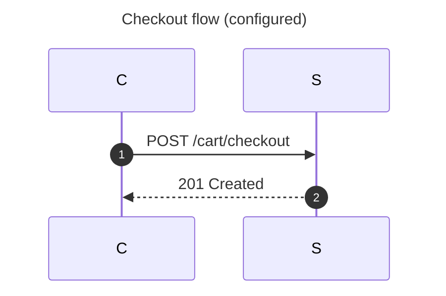

# Native Mermaid configuration

Configuration reaches the native renderer from YAML frontmatter and from
`%%{init: {...}}%%` / `%%{initialize: {...}}%%` directives
(`libs/extras/mermaid/config.w`). The key names, value types and defaults follow
the [mermaid@12.2.0 configuration schema](https://raw.githubusercontent.com/mermaid-js/mermaid/mermaid%4012.2.0/packages/mermaid/src/schemas/config.schema.yaml).
Theme, look, layout and theme-variable keys are described in
[mermaid_styling.md](mermaid_styling.md); this page covers the sources, their
precedence and the per-family keys.

Examples: [configured-sequence.mmd](../../examples/mermaid/configured-sequence.mmd),
[configured-gantt.mmd](../../examples/mermaid/configured-gantt.mmd).

## Sources and precedence

Every source becomes the same flat dotted keys (list items are numbered:
`timeline.sectionFills.0`) and passes one validator, so frontmatter and
directives accept the same keys and report the same diagnostics. Sources apply
in order: frontmatter first, then every directive in document order; a later
source overrides an earlier one key by key, and a later list or color mapping
replaces an earlier one as a whole. Repeating a key inside one source is an
error.

Directives may appear before the header (after any frontmatter) or anywhere
in the body, as upstream allows. They may span lines; the rest of the
directive's last line must be blank. The diagram parsers skip them like `%%`
comments, and the source stays byte-for-byte saveable. `%%{wrap}%%` sets
`wrap: true`; directives with other names are ignored, as upstream ignores
them. Directive objects are JSON or JSON5-ish: quoted or bare keys and values,
numbers, booleans, nested objects, arrays and trailing commas. Double-quoted
strings take `\" \\ \/ \n \t \r \' \xHH \uHHHH \UHHHHHHHH` escapes; control
characters (other than tab and newline) and surrogates are rejected.

Frontmatter is a bounded YAML subset:

- block mappings at any consistent space indentation (tabs are rejected), `#`
  comment lines and trailing comments, plain or quoted keys (a key may not
  contain `.`);
- block sequences (`- item`, including compact `- key: value` mappings, nested
  `- - item` lists and sequences at their key's indentation) and flow
  collections (`[a, b]`, `{k: v}`, nested, spanning lines);
- plain scalars; single-quoted scalars with `''`; double-quoted scalars with
  the escapes above;
- literal and folded block scalars (`|`, `>`) with strip/keep chomping (`-`,
  `+`) and an indentation indicator (`|2`);
- anchors (`&name`) on any value, aliases (`*name`) in block and flow context,
  and merge keys (`<<: *a`, `<<: [*a, *b]`): explicit keys win over merged
  ones and an earlier merge wins over a later one.

Single- and double-quoted scalars may continue over following lines (YAML
1.2 line folding: a line break becomes a space, each blank line a newline,
the white space around a break is dropped, and a `\` before the break in
double quotes joins the lines). Keys may contain `.` only as members of the
icon name maps (`treeView.filenameIcons`, `treeView.extensionIcons`),
where file names and extensions are keys; anywhere else a dotted key is an `invalid frontmatter key`, because configuration
paths are dot-joined. Tags (`!!str`), complex keys (`?`) and multi-line
plain scalars are rejected. Top-level `title` must be a scalar;
`displayMode` is upstream's gantt shorthand for `config.gantt.displayMode` and
wins over it. Other top-level fields are ignored.

### Bounds

At most 512 entries (after alias and merge expansion, so a "billion laughs"
document stops at the entry limit instead of growing), eight levels of nesting
(`config.xyChart.xAxis.showLabel` is four), 64 anchors, and the 1 MiB document
limit. Every diagnostic suppresses the preview.

### Unknown and unsupported keys

Keys outside the tables below are ignored deterministically: they never change
the output, and their paths are recorded in `mm_document.config_ignored` in
source order. This covers keys the native renderer deliberately leaves out,
for example `gitGraph.rotateCommitLabel` (the scene has no rotated text),
`gitGraph.nodeLabel`, `sequence.hideUnusedParticipants`,
`sequence.messageMargin`, `sequence.noteAlign`, `xyChart.xAxis.showTick` (no
category ticks are drawn), `xyChart.*.labelRotation`,
`xyChart.plotReservedSpacePercent`, `sankey.labelStyle`, `timeline.leftMargin`,
`timeline.actorColours`, `railroad.compactMode`, the requirement colors and
`elk`, `secure`, `maxTextSize` and the other global switches. Font keys
(`fontFamily`, `fontSize`, `*FontSize`) and `themeCSS` belong to the styling
work. A supported key with an invalid value is an error naming the key, for
example `sequence.actorMargin must be an integer from 0 to 1000`; a known
family section that is not a mapping is `configuration section must be a
mapping`.

## Per-family keys

Values marked "native" differ from upstream's default because the native
layout keeps its own geometry when a key is not configured; configuring the
key switches to the upstream meaning.

### Global

| Key | Values | Effect |
| --- | --- | --- |
| `wrap` | boolean | Sequence message wrapping when `sequence.wrap` is unset (`%%{wrap}%%` sets it) |

### Sequence (`sequence.*`)

| Key | Values | Effect |
| --- | --- | --- |
| `mirrorActors` | boolean, native default false | Repeats each surviving participant below its lifeline |
| `actorMargin` | integer 0–1000, native 40 | Gap between participant boxes |
| `width` | integer 20–2000, native 160 | Minimum participant box width |
| `height` | integer 20–75, native 55 | Participant box height |
| `diagramMarginX` | integer 0–1000, native 80 | Left edge of the first participant |
| `messageAlign` | `left`, `center`, `right` | Message label position along its arrow |
| `showSequenceNumbers` | boolean | Numbers messages from 1, like `autonumber` (an explicit `autonumber` wins) |
| `wrap` | boolean | Wraps message labels at the participant width plus margin; later rows move down |
| `activationWidth` | integer 1–200, native 12 | Activation bar width |

### Gantt (`gantt.*`)

| Key | Values | Effect |
| --- | --- | --- |
| `barHeight`, `barGap` | integers 4–200 and 0–200 | Bar height and row pitch (`barHeight + barGap`), with a header gap before each section; unset keeps 30 px bars on an 85 px pitch |
| `displayMode` | `compact` or empty | Packs non-overlapping tasks of a section into shared rows, labels drawn on the bars |
| `tickInterval` | count + `millisecond`/`second`/`minute`/`hour`/`day`/`week`/`month` | Axis ticks on unit boundaries whose calendar field is a multiple of the count, as d3's `interval.every` (`3day`: the 1st, 4th, ... of each month; weeks counted from 1970 and starting on `weekday`); more than 200 ticks falls back to automatic ticks; the `tickInterval` statement wins |
| `weekday` | `monday` … `sunday` (default `sunday`) | First day of weekly ticks; the `weekday` statement wins |
| `topAxis` | boolean | Natively the axis is at the top; `true` adds upstream's bottom axis, `false` keeps only the bottom one |
| `axisFormat` | strftime string (the `axisFormat` tokens) | Axis label format; the `axisFormat` statement wins |
| `leftPadding` | integer 0–1000, native 180 | Minimum width of the task label column |

### Timeline (`timeline.*`)

| Key | Values | Effect |
| --- | --- | --- |
| `disableMulticolor` | boolean, default false (upstream) | Multicolour colors each section (or each period outside a section) with a light series colour that themes repaint from `cScale`; `true` draws plain boxes |
| `sectionFills` | list of colors | Section colors, cycled; implies multicolor |
| `width` | integer 20–2000, native 170 | Minimum period column width |

### Mindmap (`mindmap.*`)

| Key | Values | Effect |
| --- | --- | --- |
| `colorBy` | `branch` (default) or `depth` | Node colour series: the root's child each node descends from, or its depth |

### TreeView (`treeView.*`, `themeVariables.treeView.*`)

| Key | Values | Effect |
| --- | --- | --- |
| `showIcons` | boolean | Adds folder icons for directories and file icons otherwise |
| `rowIndent` | integer 0–200, native 36 | Indent per level (at least 12 px) |
| `lineThickness` | integer 1–16 | Connector width (at most 8 px) |
| `defaultIconPack` | string | Kept; icon packs are never fetched |
| `filenameIcons`, `extensionIcons` | mapping of names to icon names | Icons by whole file name (`README.md`) or extension, written with or without its dot (`.ts`, `ts`); the longest matching suffix wins (`.d.ts` before `.ts`) |
| `themeVariables.treeView.labelColor`, `lineColor`, `descriptionColor`, `iconColor`, `highlightStroke` | colors | Label, connector, description, icon and `highlight` outline colours |
| `themeVariables.treeView.highlightBg` | any CSS value | `highlight` row fill when it is a plain colour (native tint otherwise) |

### XY chart (`xyChart.*`)

`xAxis` is the category axis and `yAxis` the value axis in either orientation.

| Key | Values | Effect |
| --- | --- | --- |
| `width`, `height` | integers 100–5000 (defaults 700 × 500 once either is set) | Chart size; unset keeps the native 600+ px category axis and 400 px value axis |
| `chartOrientation` | `vertical`, `horizontal` | Horizontal bars; the `horizontal` header keyword also selects it |
| `showDataLabel` | boolean | Value labels past bar ends and beside line points |
| `showTitle` | boolean | Hides the chart title when false |
| `showLegend` | boolean | Hides the series legend when false |
| `xAxis.showLabel`, `xAxis.showTitle`, `xAxis.showAxisLine` | booleans | Category labels, axis title and axis line |
| `yAxis.showLabel`, `yAxis.showTitle`, `yAxis.showTick`, `yAxis.showAxisLine` | booleans | Value labels, axis title, grid/tick lines and axis line |

### Sankey (`sankey.*`)

| Key | Values | Effect |
| --- | --- | --- |
| `nodeAlignment` | `left`, `right`, `center`, `justify`; native `left` | Column assignment as d3-sankey: `justify` moves sinks to the last column, `right` ranks from the sinks, `center` moves sources next to their nearest target |
| `linkColor` | `source`, `target`, `gradient`, or a color | Ribbon color; `gradient` is the native blend of both ends; named modes also color the nodes |
| `nodeColors` | mapping of node id → color | Node colors (also used by `linkColor`) |
| `showValues` | boolean | Hides the flow values when false |
| `prefix`, `suffix` | strings up to 32 bytes | Around each flow value |
| `nodeWidth` | integer 1–200, native 20 | Node bar width |
| `nodePadding` | integer 0–500, native 50 | Gap between nodes of a column |
| `width`, `height` | integers 100–5000 | Column pitch from the width; column value height `height − 200` |

### Radar (`radar.*`)

| Key | Values | Effect |
| --- | --- | --- |
| `width`, `height`, `marginTop`, `marginRight`, `marginBottom`, `marginLeft` | integers | Once any is set, the radius is half the smaller inner extent (upstream 600 × 600, margins 50); unset keeps a 200 px radius at (300, 300) |
| `axisScaleFactor` | number 0–10 (default 1) | Axis line length relative to the radius |
| `axisLabelFactor` | number 0–10, native 1.125 | Axis label distance relative to the radius |
| `curveTension` | number 0–1, default 0.17 (upstream) | Circle-graticule curves are closed Catmull-Rom splines sampled into segments; 0 keeps straight edges; polygon graticules are always straight |

`min`, `max`, `ticks`, `graticule` and `showLegend` are radar statements, not
configuration.

### GitGraph (`gitGraph.*`)

| Key | Values | Effect |
| --- | --- | --- |
| `showBranches` | boolean | Hides branch labels and lines when false |
| `showCommitLabel` | boolean | Hides commit ids when false (tags stay) |
| `mainBranchName` | string up to 64 bytes | Name of the initial branch, used by `checkout`/`merge` |
| `mainBranchOrder` | integer 0–1000000 | Lane order of the initial branch, as `order:` does for other branches |
| `parallelCommits` | boolean | Commits at the same ancestry depth share a column |

### Railroad (`railroad.*`)

| Key | Values | Effect |
| --- | --- | --- |
| `showMarkers` | boolean | Hides the start/end markers when false |
| `horizontalSeparation` | integer 0–200, native 30 | Gap between sequence items |
| `verticalSeparation` | integer 0–200, native 20 | Gap between alternatives |
| `strokeWidth` | integer 1–16 | Width of every line and outline |
| `terminalFill`, `terminalStroke`, `nonTerminalFill`, `nonTerminalStroke`, `lineColor` | colors | Terminal/nonterminal boxes and connections |

### Requirement (`requirement.*`)

| Key | Values | Effect |
| --- | --- | --- |
| `rect_min_width`, `rect_min_height` | integers 0–2000 | Minimum requirement/element box size |

### C4 (`c4.*`)

| Key | Values | Effect |
| --- | --- | --- |
| `c4ShapeInRow`, `c4BoundaryInRow` | integers 1–100 (upstream 4 and 2) | Validated and stored for the C4 row layout (`mm_config_number(d, c"c4.c4ShapeInRow", 4)`) |

### Existing sections

`flowchart.nodeSpacing`, `flowchart.rankSpacing`, `flowchart.curve`,
`packet.bitsPerRow`, `packet.bitOrder` and `kanban.ticketBaseUrl` keep their
dedicated handling ([mermaid_styling.md](mermaid_styling.md), the packet and
kanban references). Only these keys and `theme`, `look`, `layout` and
`themeVariables` select a resolved theme palette; per-family keys leave the
unconfigured palette alone.

## API

Validated values live in `mm_document.config` (keys below `config.`), moved
from the source envelope into the parsed document before the family parser
runs, so parsers can read them too (gitGraph does). Read them with
`mm_config_value`, `mm_config_flag`, `mm_config_number`, `mm_config_milli`
(thousandths), `mm_config_count` and `mm_config_item` (lists) from
`model.w`. To support a new key, add a line to `mm_config_specs()` in
`config.w` (kinds: boolean, integer or decimal range, enumeration, color,
bounded string, duration, list or mapping of colors) and read it where the
family renders.

## Checks

`./wbuild config_yaml_test config_yaml_64_test` covers lists, block scalars,
escapes, anchors, aliases and merges, alias expansion bounds, directives in
the body of every parser family, precedence, `displayMode`, ignored keys and
every new diagnostic. `./wbuild config_family_test config_family_64_test`
renders each supported key and checks its effect on the scene (and SVG), and
checks that unsupported keys leave the SVG byte-identical.
