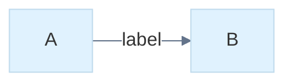

# Native Mermaid styles and themes

The W library, SVG exporter and native desktop preview share the same resolved
colors and stroke widths. This adds a bounded subset of Mermaid 12.2.0 styling;
it is not a CSS engine or a pixel-identical implementation of Mermaid themes.
Reference syntax: [flowcharts](https://mermaid.js.org/syntax/flowchart.html),
[ER diagrams](https://mermaid.js.org/syntax/entityRelationshipDiagram.html),
[class diagrams](https://mermaid.js.org/syntax/classDiagram.html) and
[theme configuration](https://mermaid.js.org/config/theming.html).

## Diagram statements

Flowchart, ER, class, state, requirement and use-case diagrams accept `style ID properties` and
`classDef NAME properties`. `style` and `classDef` can target comma-separated
names. Flowchart, ER and state diagrams accept `class ID,ID NAME`; class diagrams
use `cssClass "ID,ID" NAME` so `class` remains a class declaration. `cssClass`
works in these families. Flowchart/ER nodes and class declarations accept
inline `:::NAME` assignment. Style classes may be defined after they are used;
a missing definition produces a diagnostic. Existing graph groups can be styled.

Supported properties are:

| Property | Accepted values |
| --- | --- |
| `fill`, `stroke`, `color` | `#RGB`, `#RRGGBB`, supported names, `none`, `transparent` |
| `stroke-width` | Integer 1–16, optionally followed by `px` |

The supported color names are black, white, red, green, blue, yellow, cyan,
magenta, gray, grey, orange, purple, pink, navy, teal and lime. Hex digits may be
upper or lower case; names and property names are case sensitive. Unrecognized
properties, URLs, arbitrary CSS functions and invalid values fail explicitly.

A `classDef default` supplies node defaults. Assigned classes then apply in
assignment order; explicit `style` properties take precedence. Repeated class
or direct style declarations merge their properties, with later values replacing
earlier values. Limits are 128 class definitions, 16 properties per statement,
and 4 KiB of assigned class names per node, in addition to the document limits.

Fillable rectangles, rounded rectangles, diamonds, circles, ER tables, UML
classes and groups use the resolved palette. Semantic filled endpoint symbols
continue to use the stroke color. Transparent fills preserve the native preview
behind their outlines. Stroke widths and colors are carried by the display list,
so native rendering and SVG use the same values. Node styles do not recolor the
relationship connecting two nodes. `linkStyle default stroke:blue` supplies edge
defaults; `linkStyle 0,2 stroke:red,stroke-width:4,color:green` overrides source-order
edge indices. Indices must refer to already declared edges. Link styles accept
`stroke`, `stroke-width` and label `color`; explicit edge values override defaults.
They apply to the shared graph renderer, including arrows and endpoint markers.

## Configuration: frontmatter and init directives

Configuration comes from YAML frontmatter, from `%%{init: {...}}%%` /
`%%{initialize: {...}}%%` directives anywhere in the diagram, or both. All
sources become the same dotted keys and pass one validator; later sources
override earlier ones key by key (frontmatter, then directives in order).
Frontmatter is a bounded YAML subset with lists, block scalars, anchors,
aliases, merge keys and escapes. The sources, precedence, YAML subset, bounds
and the per-family keys (sequence, gantt, timeline, xyChart, sankey, radar,
gitGraph, railroad, requirement, c4) are documented in
[mermaid_config.md](mermaid_config.md). The keys below are the theme, look,
layout and flowchart settings.

| Key | Accepted values |
| --- | --- |
| `title` (frontmatter only) | scalar string |
| `theme` | `default`, `base`, `dark`, `forest`, `neutral`; `neo`, `neo-dark`, `redux`, `redux-dark`, `redux-color`, `redux-dark-color` as native approximations |
| `look` | `classic`; `neo` is accepted and renders with classic geometry |
| `layout` | `dagre` (native layered), `force` |
| `themeVariables.*` | see below; any theme |
| `flowchart.nodeSpacing`, `flowchart.rankSpacing` | integer 0–500 |
| `flowchart.curve` | `basis`, `linear`, `step`, `stepBefore`, `stepAfter` |
| `packet.bitsPerRow`, `packet.bitOrder` | see the packet family |

Keys that are not supported natively — `fontSize`, `fontFamily`, `themeCSS`,
unsupported diagram settings — are ignored deterministically and recorded in
`mm_document.config_ignored`; invalid values of supported keys, such as
`look: handDrawn`, produce a diagnostic. The theme names select deterministic
native palettes; `dark`, `neo-dark`, `redux-dark` and `redux-dark-color` are dark
modes and paint a dark preview/SVG background. They keep the intent of upstream
themes rather than reproducing upstream CSS or typography.

### Theme variables

`themeVariables` works with every theme. Values are `#RGB`, `#RRGGBB` or a
supported color name (quote hex values in YAML, where `#` starts a comment);
`darkMode` takes `true`/`false`. Supported variables and where they paint:

| Variable | Native use |
| --- | --- |
| `primaryColor`, `mainBkg` | node fill (`mainBkg` defaults to `primaryColor`) |
| `primaryBorderColor`, `nodeBorder` | node stroke (`nodeBorder` defaults to `primaryBorderColor`) |
| `primaryTextColor` | node text |
| `secondaryColor`, `tertiaryColor` and their `BorderColor`/`TextColor` | derivation sources |
| `clusterBkg`, `clusterBorder` | subgraph/group fill and stroke |
| `titleColor` | group labels and the document title drawn by the shared metadata pass |
| `lineColor`, `textColor` | relationships; non-node labels |
| `edgeLabelBackground` | a box behind graph edge labels |
| `background` | preview/SVG background |
| `pie1`–`pie12` | pie slices and legend keys |
| `cScale0`–`cScale11` | series colors of the other chart families (xychart, radar, …) |

A variable keeps the selected theme's native value unless it, or a variable it
derives from, is set; then it is derived as Mermaid's theme-base derives it,
with integer HSL arithmetic (hue in degrees, saturation and lightness in
percentage points, clamped; hue wraps):

| Variable | Derived from |
| --- | --- |
| `primaryBorderColor` | `primaryColor`, saturation −40, lightness −10 (+10 in dark mode) |
| `primaryTextColor` | `#333333` on a light `primaryColor` (luma ≥ 128), else `#eeeeee` |
| `secondaryColor` | `primaryColor` hue −120 |
| `tertiaryColor` | `primaryColor` hue +180, lightness +5 |
| `secondary`/`tertiaryBorderColor` | their color, as for the primary border |
| `secondary`/`tertiaryTextColor` | their color, RGB inverted |
| `lineColor` | `background`, inverted |
| `textColor` | `primaryTextColor` |
| `mainBkg`, `nodeBorder` | `primaryColor`, `primaryBorderColor` |
| `clusterBkg`, `clusterBorder` | `tertiaryColor`, `tertiaryBorderColor` |
| `titleColor` | `textColor` (upstream uses `tertiaryTextColor`) |
| `edgeLabelBackground` | `secondaryColor`, lightness −30 in dark mode |
| `pie1`–`pie3` | primary, secondary, tertiary |
| `pie4`–`pie6` | primary, secondary, tertiary, lightness −10 |
| `pie7`–`pie12` | primary with hue/lightness +60/−10, −60/−10, +120/0, +60/−20, −60/−20, +120/−10 |
| `cScale0`–`cScale2` | primary, secondary, tertiary |
| `cScale3`–`cScale11` | primary hue +30, 60, 90, 120, 150, 210, 270, 300, 330 |

`darkMode` defaults to the theme's own mode. The native palettes supply
`background`, the primary colors, `lineColor`, `textColor`, cluster colors equal
to the node colors, no edge-label box, and the fixed native series colors for
`pie*`/`cScale*`; so a theme without variables renders as before. Without any
configuration, charts keep the fixed series colors.

### Layout keys

`flowchart.nodeSpacing` and `rankSpacing` (upstream defaults 50) set the native
layered layout's gaps between nodes in a rank (2 × nodeSpacing) and between ranks
(rankSpacing + 90, leaving room for labels and markers), so the defaults
reproduce the unconfigured layout. They apply to flowcharts only; other graph
families ignore them, and the force layout uses them only for its starting positions. `flowchart.curve` routes flowchart
edges: `step` (also `stepBefore`/`stepAfter`) is the default orthogonal route,
`linear` replaces the first two legs with one straight segment and `basis` with a
sampled cubic curve; each route keeps its final axis-aligned leg so arrowheads stay
oriented. Self-loops remain orthogonal.

The source remains byte-for-byte saveable, including unsupported styles and
configuration. Invalid styles or configuration suppress the preview. The
current implementation does not support custom CSS, `stroke-dasharray`,
opacity, font configuration (`fontSize`, `fontFamily`), the hand-drawn look
or external stylesheets. Classes refer to
existing node identifiers; quoted ER display aliases are not style identifiers.

Example: [styled.mmd](../../examples/mermaid/styled.mmd).

## Checks

`./wbuild style_test style_64_test mermaid_style_native_test` covers style
precedence, forward definitions, all four graph families, fillable shapes,
SVG/native palette parity, transparent interiors, nested clipping, theme
variables, malformed input, truncation, budgets and owned scene lifetime.
`./wbuild config_test config_64_test` covers palette derivation, native theme
stability, variables with every theme and dark mode, pie/cScale series colors,
init directives (quoting, multi-line, fenced, frontmatter override, line numbers),
relaxed frontmatter, spacing and curves, every configuration diagnostic, the
entry budget and truncated prefixes; `config_yaml_test` and
`config_family_test` cover the YAML subset and per-family keys
([mermaid_config.md](mermaid_config.md#checks)).
