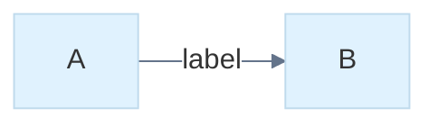

# Native Mermaid styles and themes

The W library, SVG exporter and native desktop preview share the same resolved
colors, strokes, dashes, opacity and fonts. This is a bounded subset of Mermaid
12.2.0 styling: a documented CSS subset rather than a CSS engine, and upstream
theme values rather than pixel-identical upstream rendering.
Reference syntax: [flowcharts](https://mermaid.js.org/syntax/flowchart.html),
[ER diagrams](https://mermaid.js.org/syntax/entityRelationshipDiagram.html),
[class diagrams](https://mermaid.js.org/syntax/classDiagram.html) and
[theme configuration](https://mermaid.js.org/config/theming.html).

## Diagram statements

Flowchart, ER, class, state, requirement, use-case, swimlane and block diagrams
accept `style ID properties` and `classDef NAME properties`. `style` and
`classDef` can target comma-separated names. These families accept
`class ID,ID NAME`; class diagrams use `cssClass "ID,ID" NAME` so `class`
remains a class declaration. `cssClass` works in these families. Inline
`:::NAME` assignment works on flowchart/ER/use-case/swimlane nodes, class
declarations and states. Style classes may be defined after they are used; a
missing definition produces a diagnostic. Existing graph groups can be styled.

Supported properties (the classDef property set, shared by `style`,
`classDef`, `themeCSS` and the per-family statements below):

| Property | Accepted values | Native effect |
| --- | --- | --- |
| `fill`, `stroke`, `color` | `#RGB`, `#RRGGBB`, supported names, `none`, `transparent` | shape fill, outline, label text |
| `stroke-width` | 1–16, optionally `px` | outline width |
| `stroke-dasharray` | `none`, `0`, or one or two 1–64px lengths separated by a space or a comma (`5 3`, `5\,3`; the documented unescaped `9,5` is read as one value) | dashed outlines and lines |
| `stroke-dashoffset`, `animation`, `animation-name`/`-duration`/`-timing-function`/`-iteration-count`/`-direction`/`-delay` | a length; CSS keywords, names and times | validated, not drawn: the scene is static, so an animated dashed edge shows its dash pattern without motion |
| `opacity`, `fill-opacity` | 0–1 (`0.25`) or a percentage | whole-primitive / fill alpha |
| `font-weight` | `normal`, `bold`, `bolder`, `lighter`, 100–900 (≥ 600 is bold) | bold label runs |
| `font-style` | `normal`, `italic`, `oblique` | italic label runs |
| `font-size` | 8–72, optionally `px` | label size; the node is measured at that size |
| `font-family` | one quoted or plain family name | SVG `font-family`; native text keeps the bundled face |
| `rx`, `ry` | 0–64, optionally `px` | one uniform corner radius |

The supported color names are black, white, red, green, blue, yellow, cyan,
magenta, gray, grey, orange, purple, pink, navy, teal and lime. Hex digits may be
upper or lower case; names and property names are case sensitive. Unrecognized
properties (`text-shadow`, `filter`, ...), URLs, arbitrary CSS functions and
invalid values fail explicitly with the supported list. At most 32 distinct font
families are kept per document.

A `classDef default` supplies node defaults. Assigned classes then apply in
assignment order; explicit `style` properties take precedence. Repeated class
or direct style declarations merge their properties, with later values replacing
earlier values. Limits are 128 class definitions, 16 properties per statement,
and 4 KiB of assigned class names per node, in addition to the document limits.

Fillable rectangles, rounded rectangles, diamonds, circles, ER tables, UML
classes and groups use the resolved palette. Semantic filled endpoint symbols
continue to use the stroke color. Transparent fills preserve the native preview
behind their outlines. Every property is carried by the display list, so native
rendering and SVG use the same values. Node styles do not recolor the
relationship connecting two nodes. `linkStyle default stroke:blue` supplies edge
defaults; `linkStyle 0,2 stroke:red,stroke-width:4,color:green` overrides source-order
edge indices. Indices must refer to already declared edges. Link styles accept
the same properties; explicit edge values override defaults.
They apply to the shared graph renderer, including arrows and endpoint markers,
and to swimlane edges.

### Per-family styling

| Family | Styling forms |
| --- | --- |
| State | `style`, `classDef`, `class`, and `:::NAME` after a state declaration, a state reference or a transition target. Start/end pseudo-states cannot be styled (as upstream); fork/join bars can |
| Mindmap | `:::NAME` lines assign classes; classes come from `themeCSS` (mindmap has no `classDef`). Under a theme each top-level branch takes its `cScale` color, lightened per depth |
| TreeView | `name :::a b ## description`; classes come from `themeCSS`, plus upstream's built-in `highlight` (highlightBg/highlightStroke). `icon(...)` is rejected |
| Treemap | `:::NAME` on sections and leaves, `classDef`, and `style "Label" properties` (direct styles beat classes). Cells use a per-depth palette: each top-level section takes a series color (`cScale` under a theme), lighter as cells nest |
| Venn | `style A properties` (a set or text node) and `style A,B properties` (the union of exactly those sets; a fill draws the shared region). Sets are translucent filled discs (`venn1`–`venn8` under a theme) |
| Packet | `classDef`, `:::NAME` after a field label, and `style "Label"` or `style <first bit>` |
| Radar | `style curveId properties`; a fill draws the curve's area (fill-opacity 0.5 unless given) |
| Swimlane | `style`, `classDef`, `class` and `:::NAME` on nodes and lanes, `linkStyle` on edges; circles and decisions are fillable |
| Use case | `style`, `classDef`, `class`, `:::NAME` after an actor, use case or boundary |
| Block | node styles as above; `-.->`/`-.-` draw dotted links and `==>`/`===` thick (4px) links |
| C4 | `UpdateElementStyle` (`$bgColor`, `$fontColor`, `$borderColor`) and `UpdateRelStyle` (`$textColor`, `$lineColor`) set fill, color and stroke (see the C4 family) |
| Quadrant | point styles and classes (see the data family) |

Style rules in data charts name existing items: an unmatched target fails with
`style target matches no item`.

### themeCSS

`themeCSS` (configuration) accepts `.name[, .name ...] { property: value; ... }`
rules whose declarations use the property set above; `/* comments */` are
skipped and `!important` is accepted and ignored. Each rule merges into the
named class definitions (creating them), beneath the diagram's own `classDef`
statements, so `class`, `:::` and the mindmap/TreeView class lines can assign
them. Other selectors (`#id`, element or descendant selectors), at-rules and
malformed text fail with `themeCSS supports .class { property: value; } rules`.
At most 64 rules are read.

### Fonts

`fontFamily` (or `themeVariables.fontFamily`) takes a CSS font-family list of
names, quotes, commas and spaces and becomes the SVG default `font-family`.
`fontSize` (or `themeVariables.fontSize`) takes 8–72 (optionally `px`) and
drives text metrics: label widths, line height and wrapping are measured at
that size, so nodes grow with the font, and SVG text carries the size. Native
rendering scales the bundled metric-compatible face; it does not load other
font families.

## Configuration: frontmatter and init directives

Configuration comes from YAML frontmatter, from `%%{init: {...}}%%` /
`%%{initialize: {...}}%%` directives anywhere in the diagram, or both. All
sources become the same dotted keys and pass one validator; later sources
override earlier ones key by key (frontmatter, then directives in order).
Frontmatter is a bounded YAML subset with lists, block scalars, anchors,
aliases, merge keys and escapes. The sources, precedence, YAML subset, bounds
and the per-family keys (sequence, gantt, timeline, xyChart, sankey, radar,
gitGraph, railroad, requirement, c4) are documented in
[mermaid_config.md](mermaid_config.md). The keys below are the theme, look,
layout and flowchart settings.

| Key | Accepted values |
| --- | --- |
| `title` (frontmatter only) | scalar string |
| `theme` | `default`, `base`, `dark`, `forest`, `neutral`, `neo`, `neo-dark`, `redux`, `redux-dark`, `redux-color`, `redux-dark-color` |
| `look` | `classic`, `neo` (drop shadows and gradient outlines), `handDrawn` (seeded sketch strokes); see below |
| `handDrawnSeed` | integer 0–1000000000 (0: a fixed per-shape seed) |
| `fontFamily`, `fontSize`, `themeCSS` | see Fonts and themeCSS above |
| `layout` | `dagre` (native layered), `force`, `elk` (graph families only; drawn with the native layered layout, see below) |
| `themeVariables.*` | see below; any theme |
| `flowchart.nodeSpacing`, `flowchart.rankSpacing` | integer 0–500 |
| `flowchart.curve` | `basis`, `linear`, `step`, `stepBefore`, `stepAfter` |
| `packet.bitsPerRow`, `packet.bitOrder` | see the packet family |

`layout: elk` selects upstream's ELK layered engine, which has no native port.
Rejecting it would refuse otherwise supported diagrams (upstream's own
agentflow and flowchart examples use it), and its layered algorithm is the
closest native relative, so `elk` is accepted for the same graph families as
`force`, recorded (`mm_document.layout_algorithm` is 2) and laid out exactly
as `dagre`. ELK-specific geometry (port-aware routing, `elk.*` options and
per-flow `algorithm` values such as `elk.rectpacking`) is not reproduced;
the conformance corpus records such examples as partial. Other layout names
fail with `supported layouts: dagre, force, elk (drawn with the native layered
layout)`, and `force` or `elk` on a non-graph family fails with `force and
elk layouts are only supported for graph diagrams`.

Keys that are not supported natively — unsupported diagram settings — are
ignored deterministically and recorded in `mm_document.config_ignored`;
invalid values of supported keys, such as `look: sketch`, produce a
diagnostic.

### Themes

Each theme resolves every variable to the values upstream mermaid@12.2.0's
`theme-*.js` computes (translucent upstream colors are composited over the
theme background), including the redux and neo families. `dark`, `neo-dark`,
`redux-dark` and `redux-dark-color` are dark modes and paint a dark
preview/SVG background; `base` paints its `#f4f4f4` background. Themes also set
the label font size (16px, 14px for neo/redux) and the node stroke width (1px,
2px for neo/redux) and name upstream's theme `fontFamily` as the SVG default
face: `"trebuchet ms", verdana, arial, sans-serif` for the classic five,
`arial, sans-serif` for neo/neo-dark and `"Recursive Variable", arial,
sans-serif` for the redux family; a configured `fontFamily` wins. Fallback:
the only bundled native face is Liberation Sans, metric-compatible with the
Arial every theme family lists, so text is measured (and natively drawn) with
Arial advances: exact for neo, while a browser that has Trebuchet MS or
Recursive installed draws slightly different widths inside the same boxes.
A document without any configuration keeps the native palette and the native
`Liberation Sans, Arial, Helvetica, sans-serif` face.

`look: neo` gives themed nodes, clusters and sequence actors the theme's drop
shadow (an SVG `mermaid-drop-shadow` filter; an offset shadow box natively) and,
on themes that use it, a `gradientStart` → `gradientStop` outline
(`mermaid-gradient`; natively its first stop). The classic and neo themes use
their `dropShadow` CSS `drop-shadow()` values; the redux themes name
`url(#drop-shadow)`, the filter upstream's `rendering-util/insertLookDefs.ts`
appends: an unblurred `feDropShadow` offset 4px right and down at 0.06
opacity, black on `redux`/`redux-color` and white on the dark redux themes
(`mermaid-drop-shadow` in SVG, the same offset translucent box natively).

`look: handDrawn` draws every stroked shape (nodes, clusters, edges, arrow
heads, actors, chart marks) the way upstream's rough.js renderer does with
mermaid's options (roughness 0.7, bowing 1, hachure fill with a 1.5px gap at
-41° and 1.5px weight): each outline edge is two bowed, jittered strokes,
circles are two jittered closed curves, and large fills become hachure lines
clipped to the shape (shapes under 12px keep a solid fill). Text is not
roughened. The jitter comes from rough.js's Park–Miller generator seeded with
`handDrawnSeed`, which restarts at that seed for every shape as upstream
passes it to each rough.js call; the default 0 (a fresh random seed upstream)
derives a fixed seed per primitive instead, so the same document always
draws the same strokes. The generator call order is native, so the strokes
are rough.js-like rather than byte-identical to upstream's. SVG export emits
the strokes and hachure as paths; the native preview draws the same seeded
strokes over a solid fill (at upstream's gap and weight the hachure covers
the shape). The look applies with every theme; it replaces the neo shadow
and gradient.

### Theme variables

`themeVariables` works with every theme. Values are `#RGB`, `#RRGGBB` or a
supported color name (quote hex values in YAML, where `#` starts a comment);
`darkMode` takes `true`/`false`. Supported variables and where they paint:

| Variable | Native use |
| --- | --- |
| `primaryColor`, `mainBkg` | node fill (`mainBkg` defaults to `primaryColor`) |
| `primaryBorderColor`, `nodeBorder` | node stroke (`nodeBorder` defaults to `primaryBorderColor`) |
| `primaryTextColor` | node text |
| `secondaryColor`, `tertiaryColor` and their `BorderColor`/`TextColor` | derivation sources |
| `clusterBkg`, `clusterBorder` | subgraph/group fill and stroke |
| `titleColor` | group labels and the document title drawn by the shared metadata pass |
| `lineColor`, `textColor` | relationships; non-node labels |
| `edgeLabelBackground` | a box behind graph edge labels |
| `background` | preview/SVG background |
| `pie1`–`pie12` | pie slices and legend keys |
| `cScale0`–`cScale11` | series colors of the other chart families (xychart, radar, …), mindmap branches, treemap sections |
| `noteBkgColor`, `noteBorderColor`, `noteTextColor` | sequence and UML notes |
| `actorBkg`, `actorBorder`, `actorTextColor`, `actorLineColor` | sequence participants and lifelines |
| `signalColor`, `signalTextColor` | sequence messages |
| `taskBkgColor`, `taskBorderColor`, `taskTextColor`, `activeTaskBkgColor`, `doneTaskBkgColor`, `critBkgColor` | Gantt tasks by status |
| `gridColor`, `todayLineColor`, `excludeBkgColor` | Gantt grid, today marker, excluded days |
| `sectionBkgColor`, `altSectionBkgColor` | alternating section bands |
| `git0`–`git7` | gitGraph branch lines and commits |
| `venn1`–`venn8` | Venn sets |
| `attributeBackgroundColorOdd`, `attributeBackgroundColorEven` | ER attribute rows |
| `gradientStart`, `gradientStop` | neo-look outline gradient |
| `fontFamily`, `fontSize` | see Fonts |

A variable keeps the selected theme's native value unless it, or a variable it
derives from, is set; then it is derived as Mermaid's theme-base derives it,
with integer HSL arithmetic (hue in degrees, saturation and lightness in
percentage points, clamped; hue wraps):

| Variable | Derived from |
| --- | --- |
| `primaryBorderColor` | `primaryColor`, saturation −40, lightness −10 (+10 in dark mode) |
| `primaryTextColor` | `#333333` on a light `primaryColor` (luma ≥ 128), else `#eeeeee` |
| `secondaryColor` | `primaryColor` hue −120 |
| `tertiaryColor` | `primaryColor` hue +180, lightness +5 |
| `secondary`/`tertiaryBorderColor` | their color, as for the primary border |
| `secondary`/`tertiaryTextColor` | their color, RGB inverted |
| `lineColor` | `background`, inverted |
| `textColor` | `primaryTextColor` |
| `mainBkg`, `nodeBorder` | `primaryColor`, `primaryBorderColor` |
| `clusterBkg`, `clusterBorder` | `tertiaryColor`, `tertiaryBorderColor` |
| `titleColor` | `textColor` (upstream uses `tertiaryTextColor`) |
| `edgeLabelBackground` | `secondaryColor`, lightness −30 in dark mode |
| `pie1`–`pie3` | primary, secondary, tertiary |
| `pie4`–`pie6` | primary, secondary, tertiary, lightness −10 |
| `pie7`–`pie12` | primary with hue/lightness +60/−10, −60/−10, +120/0, +60/−20, −60/−20, +120/−10 |
| `cScale0`–`cScale2` | primary, secondary, tertiary |
| `cScale3`–`cScale11` | primary hue +30, 60, 90, 120, 150, 210, 270, 300, 330 |

`darkMode` defaults to the theme's own mode. Variables a theme does not define
upstream are derived as above. Without any configuration, charts keep the fixed
native series colors. An unknown variable (`gitBranchLabel0`, `cScaleLabel0`,
`commitLabelColor`, ...) is ignored and recorded in `config_ignored`, like
other unknown keys.

### Layout keys

`flowchart.nodeSpacing` and `rankSpacing` (upstream defaults 50) set the native
layered layout's gaps between nodes in a rank (2 × nodeSpacing) and between ranks
(rankSpacing + 90, leaving room for labels and markers), so the defaults
reproduce the unconfigured layout. They apply to flowcharts only; other graph
families ignore them, and the force layout uses them only for its starting positions. `flowchart.curve` routes flowchart
edges: `step` (also `stepBefore`/`stepAfter`) is the default orthogonal route,
`linear` replaces the first two legs with one straight segment and `basis` with a
sampled cubic curve; each route keeps its final axis-aligned leg so arrowheads stay
oriented. Self-loops remain orthogonal.

The source remains byte-for-byte saveable, including unsupported styles and
configuration. Invalid styles or configuration suppress the preview. Not
supported: selectors beyond `.class` in `themeCSS`, CSS properties outside the
table above, loading font families natively (themes name upstream's
families, metrics stay Arial-compatible), TreeView icons, arbitrary diagram configuration and
external stylesheets. Classes refer to existing node identifiers; quoted ER
display aliases are not style identifiers.

Rich labels: graph labels, ER attribute comments, requirement text (Markdown
emphasis), sequence messages and notes, journey tasks, timeline entries and
use-case labels share the [text layout](mermaid_text.md): ` `, Markdown
strings, bold/italic and wrapping.

Examples: [styled.mmd](../../examples/mermaid/styled.mmd) (dark theme, neo
look, fontSize, themeCSS), [states.mmd](../../examples/mermaid/states.mmd),
[swimlanes.mmd](../../examples/mermaid/swimlanes.mmd),
[blocks.mmd](../../examples/mermaid/blocks.mmd),
[treemap.mmd](../../examples/mermaid/treemap.mmd),
[venn.mmd](../../examples/mermaid/venn.mmd),
[radar.mmd](../../examples/mermaid/radar.mmd) and
[packet.mmd](../../examples/mermaid/packet.mmd);
[theme_redux.mmd](../../examples/mermaid/theme_redux.mmd) (redux filter) and
[look_hand_drawn.mmd](../../examples/mermaid/look_hand_drawn.mmd).

## Checks

`./wbuild look_test look_64_test` covers the redux filters (light and dark),
the neo shadow, each theme family and the `fontFamily` override, unchanged
metrics, `look: handDrawn` parsing, canonical round trip and seed validation,
deterministic and seed-dependent SVG strokes, hachure bounds and every family
drawing by hand; `mermaid_style_native_test` checks the native hand-drawn
render is deterministic and seed-dependent.

`./wbuild style_test style_64_test mermaid_style_native_test` covers style
precedence, forward definitions, all four graph families, fillable shapes,
SVG/native palette parity, transparent interiors, nested clipping, theme
variables, malformed input, truncation, budgets and owned scene lifetime.
`./wbuild style_parity_test style_parity_64_test` has one fixture per CSS
property (through `style`, `classDef` + `class` and `:::`), `themeCSS`, each
font key, every theme with the neo look, every theme variable, each family
styling form, the rich labels, and the deliberately unsupported options
(`look: sketch`, other CSS properties and selectors, out-of-range font sizes, TreeView icons, styled start states, unmatched data
style targets).
`./wbuild config_test config_64_test` covers palette derivation, upstream theme
palettes, variables with every theme and dark mode, pie/cScale series colors,
init directives (quoting, multi-line, fenced, frontmatter override, line numbers),
relaxed frontmatter, spacing and curves, every configuration diagnostic, the
entry budget and truncated prefixes; `config_yaml_test` and
`config_family_test` cover the YAML subset and per-family keys
([mermaid_config.md](mermaid_config.md#checks)).
