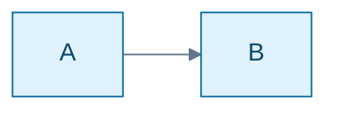

# Native Mermaid styles and themes

The W library, SVG exporter and native desktop preview share the same resolved
colors and stroke widths. This adds a bounded subset of Mermaid 12.2.0 styling;
it is not a CSS engine or a pixel-identical implementation of Mermaid themes.
Reference syntax: [flowcharts](https://mermaid.js.org/syntax/flowchart.html),
[ER diagrams](https://mermaid.js.org/syntax/entityRelationshipDiagram.html),
[class diagrams](https://mermaid.js.org/syntax/classDiagram.html) and
[theme configuration](https://mermaid.js.org/config/theming.html).

## Diagram statements

Flowchart, ER, class, state, requirement and use-case diagrams accept `style ID properties` and
`classDef NAME properties`. `style` and `classDef` can target comma-separated
names. Flowchart, ER and state diagrams accept `class ID,ID NAME`; class diagrams
use `cssClass "ID,ID" NAME` so `class` remains a class declaration. `cssClass`
works in these families. Flowchart/ER nodes and class declarations accept
inline `:::NAME` assignment. Style classes may be defined after they are used;
a missing definition produces a diagnostic. Existing graph groups can be styled.

Supported properties are:

| Property | Accepted values |
| --- | --- |
| `fill`, `stroke`, `color` | `#RGB`, `#RRGGBB`, supported names, `none`, `transparent` |
| `stroke-width` | Integer 1–16, optionally followed by `px` |

The supported color names are black, white, red, green, blue, yellow, cyan,
magenta, gray, grey, orange, purple, pink, navy, teal and lime. Hex digits may be
upper or lower case; names and property names are case sensitive. Unrecognized
properties, URLs, arbitrary CSS functions and invalid values fail explicitly.

A `classDef default` supplies node defaults. Assigned classes then apply in
assignment order; explicit `style` properties take precedence. Repeated class
or direct style declarations merge their properties, with later values replacing
earlier values. Limits are 128 class definitions, 16 properties per statement,
and 4 KiB of assigned class names per node, in addition to the document limits.

Fillable rectangles, rounded rectangles, diamonds, circles, ER tables, UML
classes and groups use the resolved palette. Semantic filled endpoint symbols
continue to use the stroke color. Transparent fills preserve the native preview
behind their outlines. Stroke widths and colors are carried by the display list,
so native rendering and SVG use the same values. Node styles do not recolor the
relationship connecting two nodes. `linkStyle default stroke:blue` supplies edge
defaults; `linkStyle 0,2 stroke:red,stroke-width:4,color:green` overrides source-order
edge indices. Indices must refer to already declared edges. Link styles accept
`stroke`, `stroke-width` and label `color`; explicit edge values override defaults.
They apply to the shared graph renderer, including arrows and endpoint markers.

## Frontmatter themes

Accepted theme names are `default`, `base`, `dark`, `forest` and `neutral`.
They select deterministic native palettes; `dark` also paints a dark preview/SVG
background. The native palettes preserve their intent rather than reproducing
upstream CSS, typography, palette derivation or categorical colors.

`themeVariables` requires `theme: base` and accepts only the six color keys in
the example above. Values must be quoted hex colors. Primary colors style graph
nodes; `lineColor` styles relationships and `textColor` styles non-node labels.
Missing variables retain the base palette; automatic derivation of related
colors is not implemented. Native frontmatter uses two spaces under `config`
and four under `themeVariables`; unsupported config keys, themes and indentation
produce a diagnostic. Field order does not affect the resolved palette.

The source remains byte-for-byte saveable, including unsupported styles. Invalid
styles suppress the preview. The current implementation does not support
custom CSS, `stroke-dasharray`, opacity, font overrides, inline init
directives, arbitrary diagram configuration, the upstream redux/neo themes,
or external stylesheets. Classes refer to existing node identifiers; quoted ER
display aliases are not style identifiers.

Example: [styled.mmd](../../examples/mermaid/styled.mmd).

## Checks

`./wbuild style_test style_64_test mermaid_style_native_test` covers style
precedence, forward definitions, all four graph families, fillable shapes,
SVG/native palette parity, transparent interiors, nested clipping, theme
variables, malformed input, truncation, budgets and owned scene lifetime.
